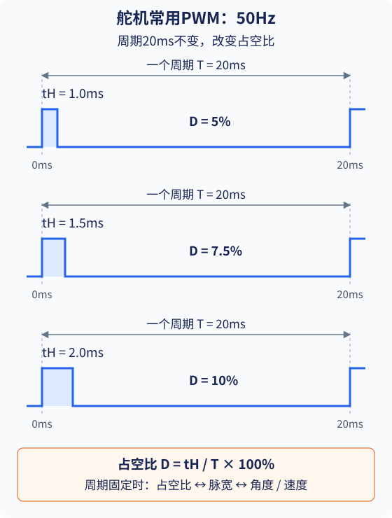
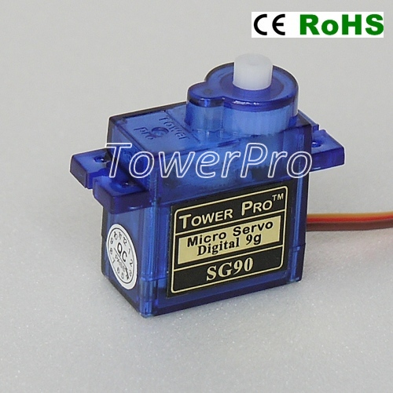
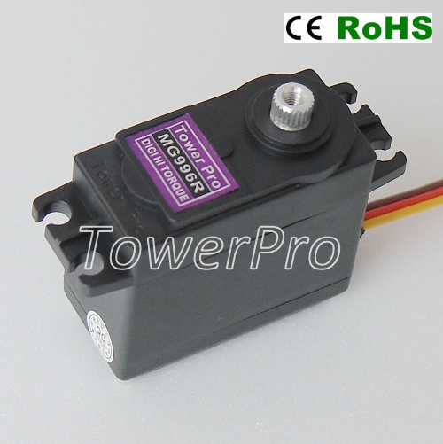
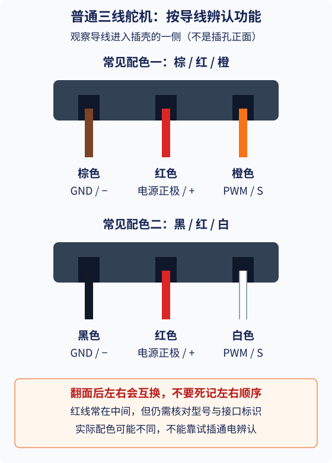
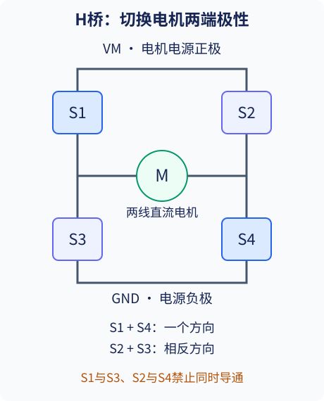
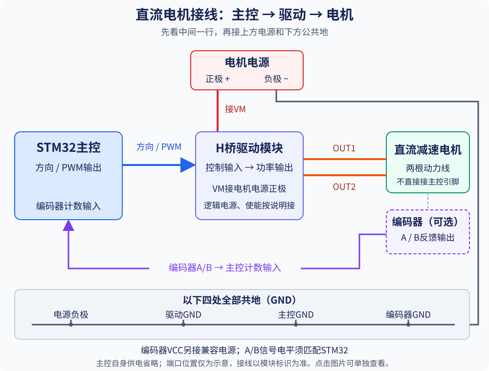
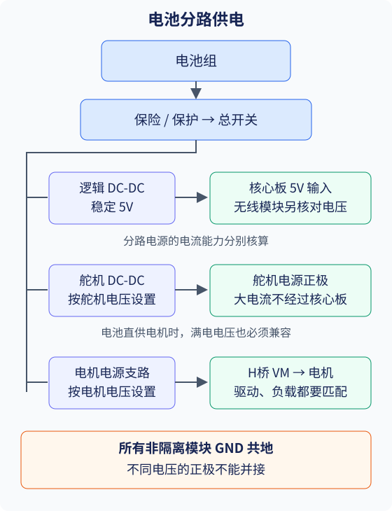
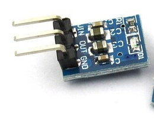
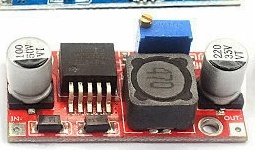
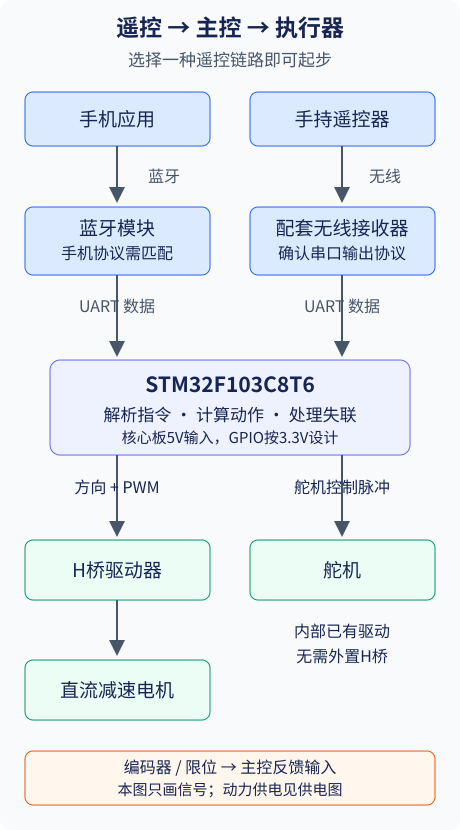

# RoboMaster 校内赛小车电控设计指南

小车的电控由电池、主控、电机驱动和遥控模块组成。电池提供电能，主控接收遥控指令，再控制电机和舵机完成行驶、抓取、抬升等动作。

搭车时，先和机械队友确定需要完成的动作，再选择电机，配好驱动和电源，最后接入主控与遥控。调试从单个部件开始，逐步做到整车联动。

## 1. 先确定小车需要哪些动作

选部件之前，先把小车需要完成的动作列清楚。底盘要跑多快、夹爪要夹多重、机械臂要抬多高，都会影响电机和电源的选择。

| 部位 | 需要确定的内容 | 对电控的影响 |
| --- | --- | --- |
| 底盘 | 整车质量、轮径、目标速度、是否爬坡、轮子数量 | 电机扭矩、转速、驱动通道数和电池电流 |
| 夹爪 | 张开多少、夹多重、是否需要一直夹紧 | 舵机角度、扭矩、持续负载和机构自锁 |
| 抬臂 | 臂长、负载、抬升角度 | 电机或舵机扭矩，是否需要减速、配重 |
| 升降机构 | 升降距离、速度、最高和最低位置 | 减速电机、上下限位开关 |
| 滚轮或传送机构 | 连续转动方向、转速、是否容易卡住 | 直流电机、驱动电流、卡滞保护 |

爬坡、过台阶和高处取物需要与机械队友一起确认轮径、重心、扭矩和机构行程。比赛尺寸、电源及器件限制以最新制作规范为准。

## 2. 电机选型：看扭矩、电压、转速和尺寸

底盘和滚轮通常用直流减速电机，夹爪和摆臂可以用舵机。两者的接线方式如下：

| 对比项 | 普通三线PWM舵机 | 普通直流减速电机（TT、MG310等） |
| --- | --- | --- |
| 内部有没有驱动 | 已有驱动电路 | 通常没有，减速箱只负责机械减速 |
| 需要外接什么 | 合适的电源、主控PWM信号，共地 | 合适的电源、成品H桥驱动模块、主控控制信号，共地 |
| 怎样让它动作 | 接通电源后，由主控发送控制脉冲 | 直接接合适电源通常会转；装车后通过驱动模块调速、换向 |
| 主控控制什么 | 角度型控位置；连续旋转型控方向和快慢 | 通过驱动模块控方向和PWM调速；精确控制需反馈 |
| 常用部位 | 夹爪、摆臂、挡板 | 底盘、升降、滚轮 |

**舵机接电源和信号即可，不另加H桥；普通直流减速电机接H桥模块，由模块带动。两者都不能靠STM32引脚供电。**

### 2.1 四个参数分别决定什么

**扭矩决定带不带得动。** 轮子推动整车、舵机抬起机械臂，都需要足够的扭矩。常见单位是N·m和kgf·cm，商品页也常写成kg·cm。1 kgf·cm约为0.098 N·m，相当于在1cm长的力臂上承受约1kg物体的重力。力臂越长，抬起相同重量需要的扭矩越大。

**电压决定接哪一路电源。** 按额定电压和允许范围供电，过压可能烧坏电机或驱动器。

**转速决定动作有多快。** rpm表示每分钟转数。减速箱降低输出转速，同时增大输出扭矩。购买时看减速箱输出轴的转速和扭矩，并查看带上负载后能达到多少转速。

**尺寸决定装不装得下。** 查看外壳长宽高、固定孔距、输出轴直径与形状，确认轮毂、联轴器或舵盘能够配套安装。

配驱动和电源时，还要看**工作电流和堵转电流**。电机通电后被卡住，称为堵转，此时电流大、发热快。机构应能顺畅运动，夹紧后尽量由机械结构保持，避免电机长时间顶住。

选扭矩时，持续工作的机构看额定扭矩；堵转扭矩用于了解短时极限。商品只写“最大扭矩”时，先向商家确认含义，再给实际负载留出余量。

### 2.2 常用电机怎么选

| 类型 | 适合的用途 | 选型时重点查看 |
| --- | --- | --- |
| TT 减速电机 | 轻载原型、简单滚轮 | 扭矩余量较小，常见无编码器版本调速较粗略；校内赛底盘优先选带编码器的减速电机 |
| MG310 减速电机 | 底盘、升降、滚轮等连续转动机构的候选 | 完整型号、减速比、扭矩、电压、堵转电流、尺寸、编码器版本 |
| 角度控制型舵机 | 夹爪开合、摆臂、挡板、有限角度转向 | 90°/180°/270°版本、扭矩、工作电压、舵盘和可用行程 |
| 360°连续旋转舵机 | 对定位要求不高的连续转动机构 | 中位停止点、方向、速度、承载和持续运行能力 |

TT、MG310同名商品可能有不同电压、减速比、转速和接口，购买时核对完整型号与参数。

**底盘推荐使用带编码器的减速电机，并加入速度闭环控制。** 编码器随电机转动输出脉冲，主控通过计数计算转速，再调整PWM，让轮速接近设定值。这样更方便控制低速行驶和左右轮速度，负载变化时也能及时调整。

常见TT电机适合轻载试验，装上较重的整车后可能出现起步费力、爬坡扭矩不足的问题。无编码器版本还需要反复试调PWM，直行和低速控制较难做好。第一次做校内赛底盘，建议把预算优先留给扭矩足够、带编码器的减速电机。

### 2.3 底盘电机：先算轮速，再估扭矩

轮径为 D 米、轮速为 n rpm 时，小车速度可粗略估算为：

```text
车速 v ≈ π × D × n / 60
所需轮速 n ≈ 60 × v / (π × D)
```

例如，轮径65mm、目标速度0.5m/s，需要轮子带载时约147rpm。购买时查看带载转速；商品只给空载转速时，装车后还要实测，因为电机带上负载后通常会变慢。

车越重、轮子越大、坡越陡，所需驱动扭矩通常越大。选择电机时，把整车质量、轮径和爬坡要求列给机械队友，一起核算持续工作扭矩。

四轮差速底盘原地转向时可能比直线行驶更费力。装车后分别测试起步、转向和爬坡，检查能否带动、是否过热。过台阶还要检查轮径、离地高度和重心。

### 2.4 机构电机：看负载到转轴的距离

抬臂最基本的关系是：

```text
所需扭矩 T ≈ 重力 × 到转轴的垂直力臂
```

例如，0.2kg的物体放在距转轴水平10cm的位置，仅托住物体就需要约2 kgf·cm的扭矩。选舵机时还要加上机械臂自身重量、摩擦和启动所需的力量，因此应选择扭矩更大的型号，并进行带载测试。

长臂抬不动时，可以缩短力臂、增加减速、使用弹簧或配重，或改为丝杆升降。夹爪也应通过连杆或自锁结构减少持续夹紧所需电流。

## 3. 舵机：角度型与360°速度型要分清

<p style="color: #d32f2f; font-weight: 700;">注意舵机控制方式和角度范围：90°、180°、270°舵机一般控制角度；普通360°连续旋转舵机一般控制方向和速度，不能直接指定旋转角度。购买前确认控制方式，安装后按实际型号标定可用角度或停止中位。</p>

### 3.1 从舵机常用的50Hz PWM开始

**普通三线PWM舵机常用50Hz控制信号，也就是每20ms重复一次。** 设置STM32定时器时，先按型号说明设置频率，再调整占空比。

PWM全称是脉宽调制。主控引脚交替输出高电平和低电平，通过调整高电平持续的时间控制舵机。STM32输出高电平时通常接近3.3V，输出低电平时接近0V。固定频率后，占空比越大，每次高电平持续的时间越长。

- **周期T**：从本次脉冲开始，到下次脉冲开始的时间。
- **频率f**：每秒重复多少个周期，f = 1 / T，单位Hz。
- **高电平脉宽tH**：一个周期内，高电平持续的时间。
- **占空比D**：高电平时间占整个周期的比例，D = tH / T × 100%。

50Hz表示每秒发送50个控制脉冲。对普通角度型舵机，保持50Hz不变，通过改变占空比设置目标角度。

[](assets/school-car/servo-pwm.svg)

图中三行频率均为50Hz。高电平分别持续1.0、1.5、2.0ms，对应5%、7.5%、10%占空比。控制时持续重复输出脉冲。

```text
占空比 D = 高电平时间 tH / 周期 T × 100%
高电平时间 tH = 周期 T × 占空比 D（用小数表示）

T = 20ms，D = 7.5%：tH = 20ms × 0.075 = 1.5ms
```

有些舵机使用0.5～2.5ms脉宽，在50Hz下对应2.5%～12.5%占空比。实际可用脉宽和角度范围按型号确认。

设置时，先按舵机说明固定周期，再调整占空比。PWM接舵机信号线，电源线则持续接到合适的电源输出。

### 3.2 占空比与角度、速度的对应关系

固定周期后，角度型舵机的占空比对应目标角度，连续旋转型的占空比对应方向和快慢。以20ms周期为例，假设角度型的5%～10%对应0°～180°，连续旋转型在7.5%附近停止：

| 输入占空比（周期固定20ms） | 该180°角度舵机的含义 | 该360°连续旋转舵机的含义 |
| --- | --- | --- |
| 5%（高电平1.0ms） | 转到0°附近并保持 | 沿一个方向持续转动 |
| 7.5%（高电平1.5ms） | 转到90°附近并保持 | 中位附近停止 |
| 10%（高电平2.0ms） | 转到180°附近并保持 | 沿相反方向持续转动 |

这张表用于说明映射关系。实际使用时，先查型号说明，再空载测试角度端点、停止中位和转动方向，确认后连接机构。

按表中的假设，0°到180°对应5%到10%占空比，可以近似按比例计算：45°是全行程的四分之一，对应占空比为5% + (10% − 5%) ÷ 4 = 6.25%，脉宽为1.25ms。换成90°或270°舵机时，按它的实际角度范围重新换算。

连续旋转型在中位附近停止；占空比低于中位时朝一个方向转，高于中位时反转。在有效调速范围内，偏离中位越多，通常转得越快。中位附近可能有一小段停止区，实际转速还会随负载和供电变化，调试时逐步调整并观察。

改变PWM频率后，需要重新计算占空比，保持脉宽符合舵机要求。

### 3.3 90°、180°、270°：控制目标角度

这类常见舵机内部已有电机、减速机构、位置反馈和控制电路。主控发送目标位置的脉冲信号，舵机转到对应位置，并在负载允许时保持。

- 90°：适合行程较小的挡板和开合机构。
- 180°：适合常见夹爪和摆臂。
- 270°：适合需要更大摆动范围的机构。

购买时分别确认角度范围和扭矩：角度范围要满足开合行程，扭矩要能带动机构。先空载测试可用角度，再安装舵盘，把程序中的最大、最小角度设在机构可活动范围内。

### 3.4 普通360°连续旋转型：控制方向和快慢

常见的普通 360°连续旋转舵机，用脉冲控制正转、反转和快慢。中位附近停止，偏离中位后转动。**它通常不能直接执行“转到90°并停住”。** 如果夹爪需要停在固定角度，优先选角度控制型。

### 3.5 映射不同，用途与程序也不同

| 需要完成的动作 | 应优先选择 | 程序如何控制 |
| --- | --- | --- |
| 夹爪张开、夹紧，挡板切换位置 | 角度控制型 | 分别标定张开角度、夹紧角度，切换目标脉宽；避免顶死 |
| 机械臂移动到某个角度并保持 | 扭矩足够的角度控制型 | 发送对应角度的脉宽，按要求持续输出控制脉冲 |
| 滚轮持续转动、简单传送 | 连续旋转型或直流减速电机 | 设置方向和快慢；需要停止时发停止指令 |

写夹爪程序时，先试出张开和夹紧对应的占空比，再用遥控按键切换。需要动作平缓时，让占空比逐步变化。

写连续旋转舵机程序时，分别设置正转、反转和停止对应的占空比。松开按键后发送停止值，舵机才会停下。

用“转动200ms再停止”控制位置时，负载和电压变化会造成落点偏差。需要固定落点的机构，优先选角度型舵机，或使用带编码器的电机；升降机构还要加上下限位。承重机械臂应配好减速或自锁结构，保证停止后能稳住负载。

### 3.6 三根线怎么接

下图是常见的小型SG90舵机。上方输出轴安装舵盘，用来连接夹爪或连杆；两侧安装耳用于固定，三根导线连接电源和主控。

[](assets/school-car/sg90-photo.jpg)

图片来源：TowerPro SG90产品资料。

下面是尺寸更大的MG996R金属齿轮舵机，常用于需要较大扭矩的机构。它的尺寸约40.7 × 19.7 × 42.9mm，厂家标注堵转扭矩为9.4 kgf·cm（4.8V）或11 kgf·cm（6V）。

[](assets/school-car/mg996r-photo.jpg)

图片与参数来源：TowerPro MG996R产品资料。商品中的“10公斤舵机”通常指约10 kgf·cm的扭矩等级。选型时结合力臂计算负载，并确认控制方式和角度范围。

普通三线PWM舵机有**电源正极、GND和信号线**。先沿着导线辨认功能，再核对接收器或驱动板的接口标识。

[](assets/school-car/servo-wires.svg)

| 功能 | 常见配色一 | 常见配色二 | 应接到哪里 |
| --- | --- | --- | --- |
| GND，标作−或G | 棕色 | 黑色 | 舵机电源负极，并与主控共地 |
| 电源正极，标作+或V | 红色 | 红色 | 满足该型号电压、电流要求的电源输出 |
| PWM信号，标作S或SIG | 橙色 | 白色 | STM32对应的定时器PWM输出引脚 |

常见插头的红色电源线在中间，两侧分别是GND和信号；部分型号使用黄色或蓝色信号线。**图中从导线进入插壳的一侧观察，翻转插头后左右位置会改变。** 接线时沿导线核对颜色，再对照型号说明和接口标识确认。

<p style="color: #d32f2f; font-weight: 700;">接线前断电，核对线色、接口标识和正负极。颜色不清楚、线束被改装或说明缺失时，先查清型号与接线定义，不要通过试插通电来猜线序。</p>

**电源接满足舵机电压和电流要求的 DC-DC 输出，信号线接主控定时器输出，GND 与主控共地。** 舵机内部已有驱动电路，不需要再串接外置 H 桥。

## 4. 直流电机驱动：直接买成品H桥模块

给直流减速电机配驱动时，直接购买完整的H桥驱动模块。电池或降压输出接模块电源，STM32接控制输入，电机两根动力线接模块输出。

H 桥用四个开关改变电机两端的电压方向。如下图，S1 与 S4 导通时，电流沿一个方向流过电机；S2 与 S3 导通时，电流反向，电机反转。

[](assets/school-car/h-bridge.svg)

成品模块已经做好这部分电路，接线时按模块标识连接即可。

### 4.1 常见模块：TB6612、AT8236、DRV8701

| 模块方案 | 特点 | 购买时看什么 |
| --- | --- | --- |
| TB6612（常见芯片TB6612FNG） | 常见模块可独立带两台小直流电机 | 每路电流、供电范围，以及电源、控制引脚的接法 |
| AT8236 | 常见商品有单路、双路等版本 | 模块能带几台电机，每路持续电流多大，如何散热 |
| DRV8701 | 常用于较大电流的直流电机模块 | 购买带功率MOS管的完整驱动板，查看整板的电流能力和散热要求 |

DRV8701模块常用于较大电流的方案，购买时查看整板的持续输出电流和散热要求。峰值电流用于检查启动等短时负载，持续电流用于检查长期运行能力。

初次调试时，接错线、电机卡住或电流过大都可能烧坏驱动板。预算允许的话，同型号驱动模块可以多买1～2块备用。更换前先查清损坏原因，再接上新板。

中文资料：[TI DRV8701产品页](https://www.ti.com.cn/product/cn/DRV8701)、[东芝TB6612FNG产品页](https://toshiba-semicon-storage.com/cn/semiconductor/product/motor-driver-ics/brushed-dc-motor-driver-ics/detail.TB6612FNG.html)、[AT8236中文数据手册](https://datasheet.lcsc.com/lcsc/2109242230_ZHONGKEWEI-AT8236_C2827823.pdf)。具体接线以模块商家的说明为准。

### 4.2 按电机参数选模块

| 参数 | 该怎么检查 |
| --- | --- |
| 电机电源 VM | 覆盖实际供电范围，包含电池满电或 DC-DC 最高输出 |
| 连续输出电流 | 能承担持续负载，结合模块散热条件确认 |
| 峰值与限流 | 能处理启动、换向和短时卡滞；峰值可维持多久也要看 |
| 逻辑输入 | 能正确识别 STM32 的3.3V电平 |
| 驱动通道数 | 每台独立控制的直流电机通常需要一个完整H桥 |
| 停止与保护 | 查清如何让电机停止，以及是否有过流、过热保护 |

每台需要独立调速、换向的电机配一路H桥。两台电机选双路模块，四台独立控制的电机配四路驱动。

### 4.3 一台直流电机的连接

[](assets/school-car/dc-motor-wiring.svg)

红线为动力供电，蓝线为主控控制信号，橙线为电机动力线，紫线为编码器A/B反馈，灰线为公共GND。编码器仅带编码器版本需要连接，VCC须另接兼容电源。

接好动力线后，再按模块说明连接逻辑电源、使能和待机引脚。程序按该模块给出的输入组合实现正转、反转和停止。换向时先减速到停，再切换方向并逐步提速，减小冲击电流。

PWM用于调速：供电和负载接近时，占空比增大，电机通常转得更快。带编码器的电机还可以测量实际转速，再由程序调整PWM。

## 5. 供电：先分电压，再算电流

### 5.1 常用电池：18650与航模锂电池

<p style="color: #d32f2f; font-weight: 700;">校内赛不允许使用不带保护板的航模软包电池。</p>

**初学者优先购买来源可靠、参数明确、带保护板的成品电池组，配套购买匹配的充电器。**

| 常见类型 | 怎么认识 | 选购时注意 |
| --- | --- | --- |
| 18650圆柱电池 | “18650”表示外形尺寸：直径约18mm、长度约65mm；带保护板的版本可能更长 | 查看具体型号的电压、容量、放电电流和保护板配置 |
| 21700圆柱电池 | 外形直径约21mm、长度约70mm | 同样要看具体型号，核对电池仓尺寸 |
| 航模锂电池，常标LiPo，俗称“软包电池” | 外面是软包装，常做成多串电池组 | 通常有动力插头和均衡插头；许多产品没有保护板，不能用于本校内赛 |

常见锂离子电池和普通航模LiPo，单节标称电压为**3.6V或3.7V，满充通常为4.2V**。磷酸铁锂单节通常为**3.2V，满充通常为3.65V**。不同体系的充电器不能混用，最终按电池标注选择。

### 5.2 电压、串并联与容量怎么看

选电池时，先看电压。标签上的电压通常是标称电压，充满后的电压会更高。例如，常见2S锂电池标着7.4V，充满后会达到8.4V。**驱动模块和降压模块都要能承受满电电压，并留出余量。**

下面按单节标称3.7V、满充4.2V的电池计算：

| 串联形式 | 含义 | 标称电压 | 满电电压 |
| --- | --- | --- | --- |
| 1S | 1节 | 3.7V | 4.2V |
| 2S | 2节串联 | 7.4V | 8.4V |
| 3S | 3节串联 | 11.1V | 12.6V |

电池组常用S和P标注接法。**S表示串联，电压相加；P表示并联，容量相加。** 例如，2S2P是两节并成一组，再把两组串联，共4节电芯。并联也能提高供电能力，整组允许输出的电流要结合电芯、保护板和接线确认。

接着看容量和放电电流。容量用mAh（毫安时）或Ah（安时）表示，**1000mAh = 1Ah**，用于估计续航。放电电流用A（安培）表示，选购时检查它能否满足电机和舵机的用电需求。

比较不同电压的电池时，可以把容量换算成能量。能量用Wh（瓦时）表示，计算方法如下：

```text
能量Wh ≈ 标称电压V × 容量mAh ÷ 1000
容量mAh ≈ 能量Wh ÷ 标称电压V × 1000
```

以相同的3.7V、2500mAh电芯为例：

| 组合 | 标称电压 | 容量 | 标称能量 |
| --- | --- | --- | --- |
| 1S1P，1节 | 3.7V | 2500mAh | 9.25Wh |
| 2S1P，2节串联 | 7.4V | 2500mAh | 18.5Wh |
| 1S2P，2节并联 | 3.7V | 5000mAh | 18.5Wh |
| 2S2P，4节 | 7.4V | 5000mAh | 37Wh |

计算Wh时使用标称电压。实际续航还受负载、降压损耗和电池停止放电时的剩余电量影响。初学者直接购买成品电池组，避免自行拼接不同型号、新旧程度或电量的电芯。

### 5.3 保护板有什么用

保护板用于监测电池，在电压、电流等出现异常时切断充电或放电。商品页也常把电池管理板称为BMS。购买时向商家确认四项：**有无保护板、适用电池类型和串数、持续放电电流、具体保护功能。** 热缩膜和电池盒只是外部包装，保护板配置要单独确认。

| 常见功能 | 作用 |
| --- | --- |
| 过充保护 | 电芯电压过高时切断充电，避免继续充入 |
| 过放保护 | 电芯电压过低时切断放电，减少过度放电损伤 |
| 过流、短路保护 | 电流异常时切断输出；具体触发电流和反应时间看型号 |
| 温度保护 | 带温度检测的产品可在温度异常时切断充放电 |
| 均衡功能 | 减小多串电芯之间的电量差异；并非所有保护板都有 |

选保护板时，持续电流要满足正常运行，短时电流能力要满足电机启动。电流能力不足时，小车可能一启动就断电。

保护板负责异常保护，充电器负责按电池要求充电，两者需要配套使用。多串电池还要确认是否有均衡功能。使用中继续做好绝缘、固定和充电看管，降低短路、碰撞和起火风险。

### 5.4 充电方式与安全

<p style="color: #d32f2f; font-weight: 700;">锂电池短路、过充、受挤压或损坏，可能起火、爆炸。禁止反接、短接、刺穿、挤压电池，禁止使用鼓包、漏液、绝缘皮破损或异常发热的电池。</p>

| 电池 | 正确的充电方式 |
| --- | --- |
| 单节18650 | 使用明确支持该电池体系的正规槽式充电器，核对充电电流 |
| 带保护板的成品电池组 | 使用厂家指定或明确匹配电池体系、串数、充电电压和电流的充电器 |
| 多串航模LiPo | 使用支持该串数的正规平衡充电器；按说明连接动力线和均衡线，选择正确电池类型与串数 |

例如，普通单节满充4.2V的2S电池组，配充电终止电压为8.4V的锂电池充电器；3S对应12.6V。选定后，再核对充电电流、插头规格和正负极。

**给电芯充电需要专用充电电路。** 5V USB电源和普通可调DC-DC模块禁止直接接电芯充电。购买充电板时确认适用串数：单节充电板用于指定的单节电池，2S、3S电池组使用相应的充电设备。

- 在学校允许的充电地点、不可燃台面上充电，远离纸张、床铺和其他易燃物，不占用疏散通道。
- 充电时有人看管，不通宵充电，充满及时断开。电池刚使用完发热时，先冷却到说明书允许的温度。
- 调试接线先断开电池；裸露接头做好绝缘，散装电芯不要与钥匙、螺丝等金属物混放。电池固定牢靠，避免碰撞和被机构夹伤。
- 发现鼓包、异味、漏液或异常发热，立即停止使用；在确保安全时断开电源。冒烟、起火时远离并报警，不徒手搬动电池。
- 废旧或损坏电池按当地要求交正规回收点，不扔进普通垃圾桶。

### 5.5 电池是总电源，各模块按需要取电

接整车电源时，电池经过总开关和保护后分成几路：主控使用稳定5V，舵机和直流电机按各自要求供电。需要降低电压的支路接DC-DC模块。

**不同电压的正极禁止相接。按图将各模块GND连在一起，这叫“共地”，主控和驱动之间的控制信号才能正常传递。图中使用输入负极与输出负极相通的普通DC-DC模块。**

[](assets/school-car/power.svg)

**主控和电机优先使用独立的电源支路，分别由合适的DC-DC供电；电机电压合适时，也可直接接电池。** 各路GND仍按图连接。舵机动力线直接接电源输出，避开核心板排针和板载稳压器。

购买电源模块时，确认持续输出电流、短时最大电流，以及过流、短路和过热保护。有些模块在电流过大时会限流、降低输出电压，或暂时关闭输出。主控与电机共用这一路时，电机启动就可能使主控掉电重启，频繁启停和斜坡起步时更容易出现。

分路供电后，电池、保护板和总线路也要能承受整车启动电流，避免总电源先触发保护。

电池、保护板、开关、接头和线材都要承受整车电流。按满电电压检查模块输入范围，并留出余量。

### 5.6 降压供电：选带电感的DC-DC模块

**给电机和舵机降压供电，优先买带电感、效率高、电流够用的DC-DC降压模块。不要拿AMS1117、7805这类线性稳压板给整车大电流负载供电。**

线性稳压器降压时会发热，输入与输出电压差越大、负载电流越大，发热越严重。用它给电机和舵机供电，容易过热、掉电，甚至烧坏板子。核心板上的线性稳压器一般只负责板上小电流供电。

[](assets/school-car/linear-regulator-photo.jpg)

AMS1117线性稳压板用于小电流供电。[图片来源：TELESKY天猫商品图](https://tao.hooos.com/goods_Zrq74K6jT6tP3PyxJaxcBBVsVt6-aAZjjVSYZOO3A3YHX.html)

电机和舵机可以使用效率较高的DC-DC降压模块。选购时先找带电感的模块，再看输入范围、输出电压和持续电流。常见电感是绕铜线的圆环，或印有“330”“470”等字样的方块。

[](assets/school-car/dcdc-buck-photo.jpg)

右侧印有数字的深色方块是电感，蓝色带螺丝的小部件用来调输出电压。[图片来源：RISYM天猫商品图](https://tao.k7dj.com/goods-KrddQmqh3toBaKy3drSmznUJtW-PNzeejCK5Bpz9NUb.html)

调压时先断开主控、舵机等负载，接通模块输入，用万用表测量输出，再转动调压螺丝。调到所需电压后，断电接入负载，重新通电检查是否掉压、过热。模块的持续电流按商家给出的散热条件确认。

**建议准备一只万用表。** 接设备前测输出电压和正负极，排查断线时断电测通断，出现重启时检查供电电压。测量前确认表笔插孔和挡位，电流挡只用于串入电路测量，禁止直接跨接电池或电源正负极。

### 5.7 按运行和启动电流选择电源

电机和舵机刚启动时，电流往往比正常运行时大。选电源时，把同一路上可能同时启动的负载一起考虑。

例如，一路5V电源接两个舵机，每个运行电流0.4A、启动电流1.5A。两者同时启动时，电源可能需要短时提供接近3A。电源选小了，启动时容易掉压，主控也可能跟着重启。程序中让多个机构分先后启动，可以减小同时用电的压力。

选成品电池组时，把电机、舵机的数量、供电电压和启动电流列给商家，确认电池及保护板的持续、短时放电能力能否满足整车需求。

## 6. 主控：STM32F103C8T6核心板怎么用

核心板负责接收遥控指令，控制底盘和机构，并处理限位、遥控掉线等情况。常用的STM32F103C8T6核心板体积小、资料多，适合入门小车。UART是串口，用来接遥控模块；定时器用来输出PWM；GPIO是通用输入输出引脚，用来接方向信号、按键和限位开关。

### 6.1 核心板用5V输入，芯片工作在3.3V

给常见的F103C8T6核心板供电时，把稳定5V接到板上的**5V输入端**，GND接电源负极。板上的稳压器会把5V降为3.3V供芯片使用。接线前对照手中板卡的原理图，确认它支持这种供电方式。

**5V禁止接到3V3引脚或芯片VDD。** STM32芯片通常工作在3.3V，外设信号优先选兼容3.3V电平的模块。连接5V输出信号前，查引脚手册，按需要增加电平转换。

下载程序时，按板卡和下载器说明连接SWDIO、SWCLK、GND等接口。先确定由哪一路给核心板供电，同时连接USB、外部5V和下载器前，查清板卡允许的接法，避免多个电源互相供电。

### 6.2 先分配引脚资源，再焊线

| 资源 | 用途 | 规划要点 |
| --- | --- | --- |
| UART | 蓝牙模块或串口遥控接收器 | 留出一组兼容的RX/TX；有条件时另留调试串口 |
| 定时器PWM | 直流驱动调速、舵机脉冲 | 直流电机PWM与舵机常需不同频率，分配到合适的定时器 |
| GPIO | 驱动方向、使能、按键、限位 | 明确输入输出、电平和上电默认状态 |
| 编码器输入 | 测量轮速 | 选择支持编码器计数的引脚，核对信号电平 |
| SWD | 下载与调试 | 保留PA13、PA14等所需接口，避免被外设占用 |

先在CubeMX里分配引脚，再接线。舵机常用50Hz，直流电机调速通常使用更高频率，建议分配到不同定时器。同一定时器的多个PWM通道通常共用周期，分开配置更方便。

## 7. 遥控：手机蓝牙或串口遥控器

遥控模块把数据发给主控，主控解析后控制驱动器和舵机。

[](assets/school-car/control.svg)

### 7.1 手机连接蓝牙模块

小车装上支持串口透传的蓝牙模块，手机应用发送前进、后退、转向、夹爪等指令。模块把无线数据转换成UART字节，交给STM32。

购买时分别查看供电电压和串口电平。例如，模块电源端可能支持5V，串口RX端要求3.3V，接线时按各引脚要求连接。

购买前确认手机系统、应用和模块支持同一种蓝牙协议，例如经典蓝牙SPP或BLE。

蓝牙模块可以预留十来元的预算，优先选资料齐全、连接稳定的常用型号，减少调试时反复断链。购买时查看同类小车的使用反馈，装车后测试实际操控距离和电机运行时的连接情况。

### 7.2 手持串口遥控器

手持遥控器配套一个无线接收器，摇杆用于行驶和转向，按键用于控制夹爪等机构。选择串口版本时，确认接收器提供兼容STM32的TTL UART接口，并向商家索取数据格式。

配置STM32串口时，按接收器说明填写波特率、数据位、校验位，再按商家提供的数据格式读取摇杆和按键值。

普通TTL UART连接时，模块TX接主控RX，模块RX接主控TX，GND接主控GND。主控只接收数据时，可只接模块TX、供电和GND。

### 7.3 遥控掉线后让小车停止

先实现行驶速度、转向和夹爪这几项指令，再加入掉线保护。收到数据后，检查数据是否完整、数值是否在范围内，通过检查后再更新动作，并记录接收时间。

例如，可以先设置“超过300ms没有收到有效指令，底盘目标速度归零”，再根据遥控发送间隔调整时间。有些接收器在无线掉线后仍会重复发送最后的数据，这类产品要读取失联标志，或提前配置接收器的失联输出。

各机构分别设置失联动作：滚轮停止，升降停止并稳住负载，抬臂和夹爪按机构需要保持。测试前先确认承重部件断开控制后会不会下坠，并配好自锁或支撑。

## 8. 把各部分组成一辆车

下面是一套起步方案，具体型号和数量要按机械负载确认：

| 部分 | 起步配置 | 必须确认的条件 |
| --- | --- | --- |
| 主控 | 1块STM32F103C8T6核心板 | 板上有合适稳压器，稳定5V接到正确输入端 |
| 底盘 | 2或4台同规格带编码器的直流减速电机 | 扭矩、轮速、轴和安装孔匹配，程序加入速度闭环 |
| 底盘驱动 | 与独立电机数量匹配的H桥通道 | VM、电流、散热和3.3V控制电平满足要求 |
| 夹爪 | 1台角度型舵机 | 90°/180°/270°按机构行程选择，扭矩留余量 |
| 升降或其他机构 | 减速电机加驱动，或合适舵机 | 升降需要上下限位和停止策略 |
| 遥控 | 蓝牙模块配手机，或串口遥控器配接收器 | 协议、电平、供电和失联行为明确 |
| 电源 | 电池组、总开关、保护和所需DC-DC | 输入满电耐压、连续电流、启动峰值和散热合格 |
| 连接与固定 | 合适线径、端子、分电连接、固定件 | 大电流不经面包板和松动杜邦接点，接头防反接 |

装车时，把电池、电源模块和驱动板固定牢靠，焊点做好绝缘。转轴、夹爪和升降机构附近留出线束活动余量，避免拉断或夹伤导线。

电机和舵机的大电流供电线直接回到分电点，主控单独接供电和地线。控制线尽量远离电机动力线，减少电机运行时对遥控和主控的干扰。模块要求的电容等元件按说明安装。

## 9. 调试顺序：从一块板到整车

1. **先调电源。** 不接主控和电机，用万用表确认各路输出电压与极性，再检查带载时是否掉压、过热。
2. **只给核心板供电。** 完成下载、点灯和串口输出，确认复位和下载稳定。
3. **接遥控模块。** 先打印解码后的摇杆、按键和失联状态，暂不驱动电机。
4. **测试一台直流电机。** 车轮架空，从低占空比开始，确认正反转、停止和驱动温升。
5. **测试一台舵机。** 先不连接会顶死的机构，标定中位和可用范围，再带载调试。
6. **联调底盘。** 统一各轮“正转”的实际方向，逐步实现直行、后退、转向；加减速缓变，避免同时猛启动。
7. **联调机构。** 测试上下限位，限制容易碰撞的动作同时执行，检查上电和遥控掉线时机构是否安全。
8. **进行整车带载测试。** 检查行驶与夹取同时动作、电池电量降低、通信断开时的表现，并观察电源和驱动温升。

遇到异常时先停机，再按现象检查：

| 现象 | 先检查什么 |
| --- | --- |
| 电机一启动，主控就重启 | 电源是否掉压，地线是否接好，电机动力线是否干扰主控 |
| 电机抖动、转不起来 | 驱动电源和使能、动力线连接、机构是否卡住 |
| 舵机持续嗡响、发热 | 机构是否顶死，负载是否过重，程序角度是否超出行程 |

相关教程：[STM32开发](stm32.md)、[通信协议](comm.md)、[电机控制](motor.md)。

## 10. 购买参考

购买前核对所选规格的供电、电流和接口。

- [TB6612FNG直流电机驱动模块（淘宝）](https://e.tb.cn/h.j27bomcRVvh7B46?tk=2TPKTGQRgTJ)：用于小直流电机正反转与PWM调速；确认所选版本的通道数、电流和供电范围。
- [无线摇杆按键遥控手柄（淘宝）](https://e.tb.cn/h.jY8X7JVlSgNTeRO?tk=LVKGTGQQsVp)：用于底盘遥控和机构按键操作；确认是否含接收器，以及接收端是否支持UART输出。
- [AT8236双路带稳压驱动模块（淘宝）](https://e.tb.cn/h.jcu9Eape2c2pRIf?tk=4gdUTGQkQFL)：用于两台直流电机控制；核对每路持续电流，板载稳压输出也要单独检查电压和电流能力。
- [DRV8701E单路/双路驱动模块（淘宝）](https://e.tb.cn/h.jY8eC1qvcVcpycx?tk=5D1ZTGQO6Bw)：用于直流电机驱动，按需要选择单路或双路版本；检查电机电压、整板电流和散热要求。
- [PS2式2.4G无线遥控手柄（淘宝）](https://e.tb.cn/h.jcuO0jx4FIxPlCO?tk=JKAwTGQmvh8)：用摇杆和按键操作小车；购买时确认接收器协议，PS2同步串行版本需要对应的引脚接法和驱动程序。
