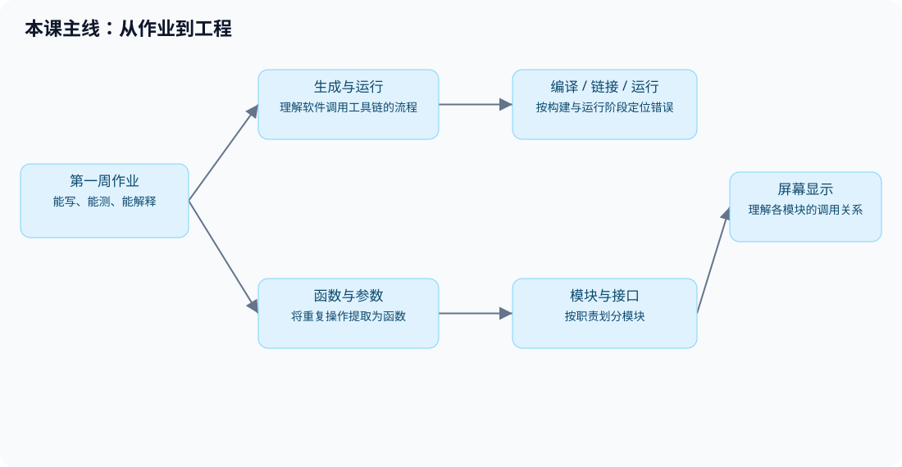
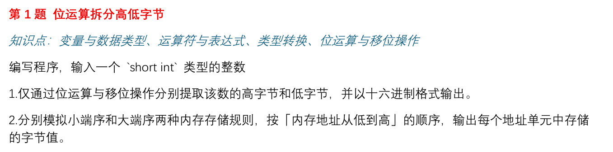
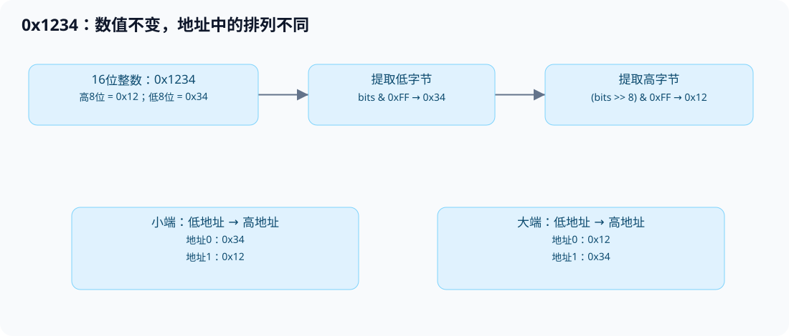
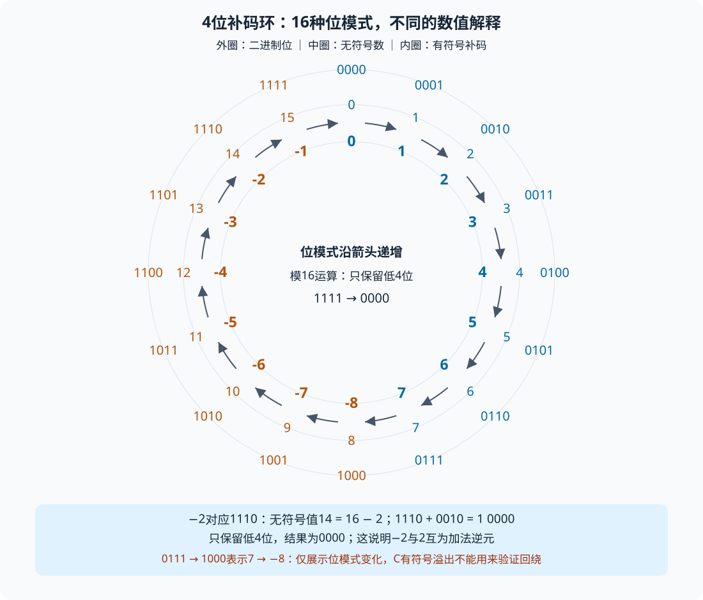
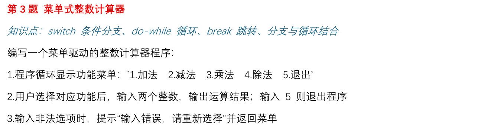
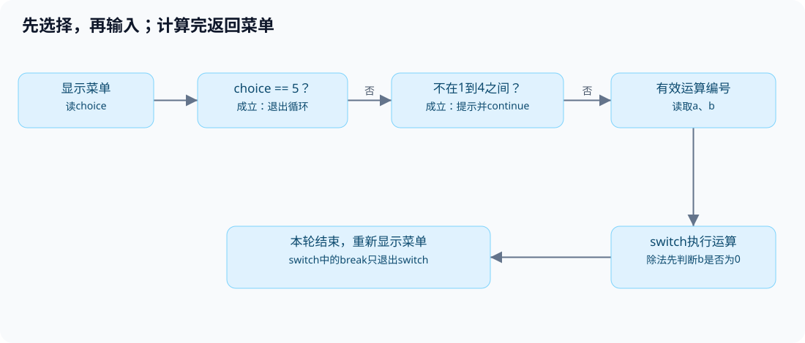
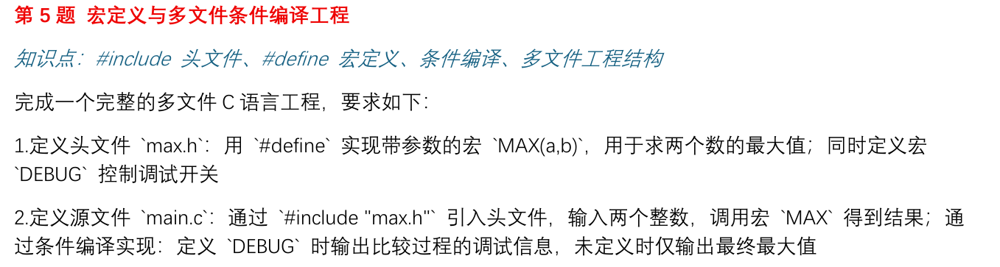
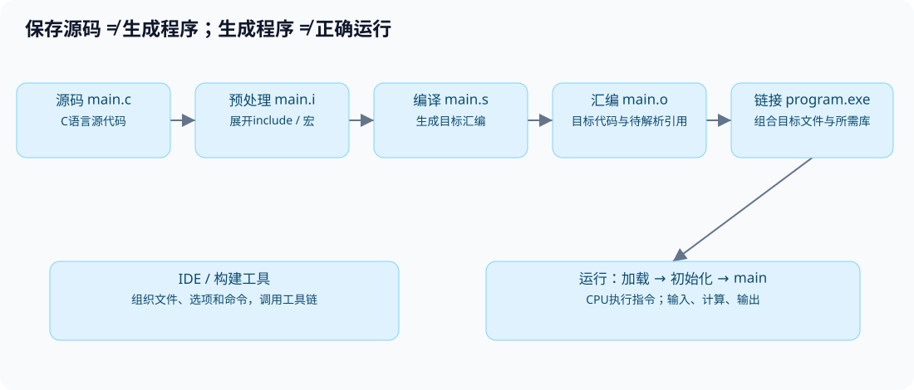
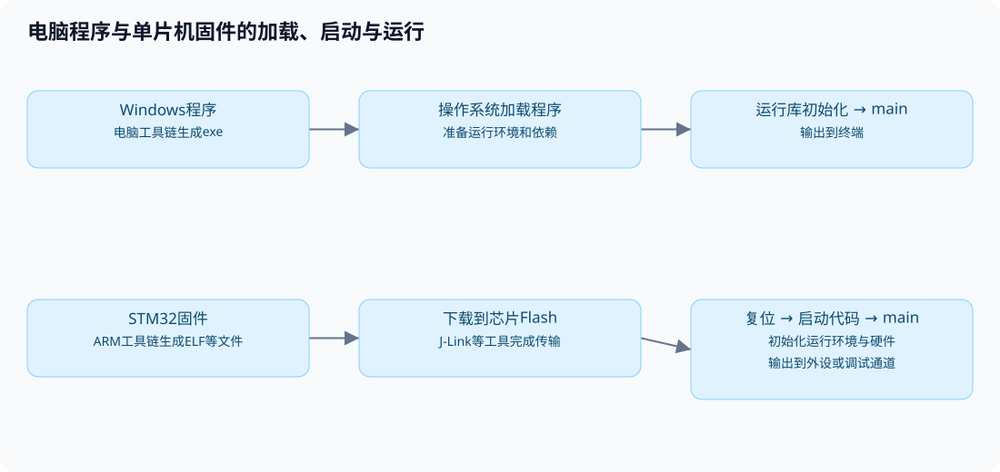
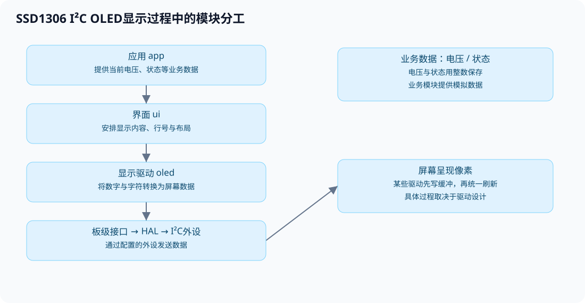

# 第二次培训：第一次作业讲评与模块化工程

> 苍穹战队 · 电控组培训｜第一周作业讲评 / 第二周函数与模块化

## 学习目标

在基本语法、流程控制和预处理的基础上，进一步学习函数、数组与模块化。屏幕案例从函数接口和调用顺序入手，理解各模块的职责。

学习内容包括五题作业的实现思路、程序错误的定位方法、函数的提取与复用，以及屏幕显示过程中的模块分工。



完整源码见[逐句注释标准答案](training-02-answers.md)。[下载标准答案与示例源码](assets/training/t2/training-02-code.zip)，解压后可以按下文的目录和命令编译。

## 第一部分：作业讲评与程序如何运行

### 1. 第1题：位运算拆分字节与大小端



**题意**：输入一个`short int`，用位运算提取高低字节，并按地址从低到高模拟两种排列。以下说明以一个字节8位、`short`占16位的环境为例。

一个16位整数可以分为高字节和低字节。例如，`0x1234`的高字节是`0x12`，低字节是`0x34`。大端与小端描述的是这两个字节在内存中的排列顺序，需要区分数值的高低位和内存地址的高低。

```c
short int number;                    /* 保存输入的short整数。 */
unsigned short bits;                /* 保存无符号数值，用于移位。 */
unsigned char high, low;             /* 分别保存两个字节。 */
scanf("%hd", &number);               /* %hd对应short；传入变量地址。 */
bits = (unsigned short)number;       /* 先转无符号，避免负数右移差异。 */
low = bits & 0xFF;                   /* 保留低8位，其他位清零。 */
high = (bits >> 8) & 0xFF;           /* 原高8位移到低位，再取出。 */
```

以上代码展示字节提取的主要步骤，完整答案还会检查`scanf`的返回值，确认输入成功。`0xFF`的低8位都是1，与它进行按位与运算可以保留低8位。`%02X`用于输出大写十六进制数，不足两位时在前面补0；需要显示`0x`前缀时，应在格式字符串中写出。



按`low, high`的顺序输出，可以模拟小端排列；按`high, low`的顺序输出，可以模拟大端排列。输出顺序由代码指定，不能据此判断本机实际采用哪种内存排列。

| 输入 | 转换后的16位值 | 高字节 | 低字节 |
| --- | --- | --- | --- |
| 4660 | 0x1234 | 0x12 | 0x34 |
| 0 | 0x0000 | 0x00 | 0x00 |
| -2 | 0xFFFE | 0xFF | 0xFE |

负数转换成`unsigned short`，在本环境按模65536得到无符号值；可避免直接对负数右移产生的实现差异。输入应在`short`范围内。

`bits & 0xFF00`可以保留高8位，但这些位仍在原来的位置。例如，`0x1234 & 0xFF00`得到`0x1200`，还需要右移8位才能得到`0x12`。

#### 常见数据类型在内存中的存储

变量的值以二进制形式保存在内存中。内存按字节编址，每个字节都有对应的地址。一个变量占用多个字节时，这些字节在变量内部连续存放。数据类型决定占用空间，以及这些二进制位如何被解释。

在常见Windows GCC/MinGW和STM32开发环境中，一个字节为8位，常用类型的大小如下：

| 类型 | 常见大小 | 存储说明 |
| --- | ---: | --- |
| `char` | 1字节 | 保存字符编码或一个小整数；普通`char`是否有符号取决于编译器配置 |
| `unsigned char` | 1字节 | 8位无符号整数，范围为0～255 |
| `short` | 2字节 | 常见为16位有符号整数 |
| `int` | 4字节 | 常见为32位有符号整数 |
| `unsigned int` | 4字节 | 常见为32位无符号整数 |
| `float` | 4字节 | 常见采用IEEE 754单精度浮点表示 |
| `double` | 8字节 | 常见采用IEEE 754双精度浮点表示 |

以上大小是这些环境中的常见配置，不是所有C平台都固定如此。C规定`sizeof(char)`为1，其他类型的实际大小可以用`sizeof`查看。`sizeof`的结果以字节为单位，使用`%zu`输出；以下代码按C99及更新的标准编译。

```c
printf("char：%zu字节\n", sizeof(char));     /* 查看char类型占用的字节数。 */
printf("short：%zu字节\n", sizeof(short));   /* 查看short类型占用的字节数。 */
printf("int：%zu字节\n", sizeof(int));       /* 查看int类型占用的字节数。 */
printf("float：%zu字节\n", sizeof(float));   /* 查看float类型占用的字节数。 */
printf("double：%zu字节\n", sizeof(double)); /* 查看double类型占用的字节数。 */
```

**整数的字节排列**

以32位的`int number = 0x12345678;`为例，数值可以拆成`12`、`34`、`56`、`78`四个十六进制字节。每两位十六进制数对应一个8位字节。假设变量从地址`0x1000`开始，排列如下：

| 地址 | 小端存储 | 大端存储 |
| --- | --- | --- |
| `0x1000` | `0x78`（最低字节） | `0x12`（最高字节） |
| `0x1001` | `0x56` | `0x34` |
| `0x1002` | `0x34` | `0x56` |
| `0x1003` | `0x12`（最高字节） | `0x78`（最低字节） |

地址用于表示存储位置，数值用于表示变量内容。上表中的地址只是示例，不代表程序实际分配的地址。大小端改变的是字节排列，同一个整数的数值含义保持不变。

**有符号整数与无符号整数**

无符号整数的所有位都用于表示非负数。32位`unsigned int`的范围为0～4294967295。常见的32位`int`采用补码表示，范围为−2147483648～2147483647。

在补码表示中，正整数按通常的二进制方式存储。例如，32位整数2表示为`0x00000002`。负整数可以通过“对应正数按位取反，再加1”得到：2按位取反得到`0xFFFFFFFD`，再加1得到`0xFFFFFFFE`，这就是−2的32位补码。小端存储时，其字节从低地址到高地址依次为`FE FF FF FF`。

同样的二进制位可能表示不同的数值。`0xFFFFFFFE`按32位有符号补码整数解释时是−2，按32位无符号整数解释时是4294967294。因此，理解数据时需要同时知道位内容和数据类型。

**用环形图理解补码**

用4位整数作为简化模型，可以得到16种位模式，从`0000`到`1111`。将它们按顺序排成圆环，沿箭头前进一格相当于位模式加1。只保留低4位时，`1111`再加1得到`0000`，因此形成一个模16的循环。



无符号解释将16种位模式依次对应到0～15。有符号补码解释则将`0000`～`0111`对应到0～7，将`1000`～`1111`对应到−8～−1。最高位为1时，有符号数值等于对应无符号值减16。例如，`1110`的无符号值是14，按补码解释为`14 − 16 = −2`。

补码表示使负数可以作为正数的加法逆元。例如，2的位模式为`0010`，−2的位模式为`1110`，两者相加得到`1 0000`。只保留低4位后为`0000`，对应结果0。对`0010`按位取反得到`1101`，再加1得到`1110`，也能求出−2的补码。

32位整数采用相同的关系，只是位模式数量变为2³²。负数−2对应的无符号值为`2³² − 2`，即4294967294，位模式为`0xFFFFFFFE`。最高位为1的32位补码，数值等于对应无符号值减2³²。

环形图用于说明固定宽度的位模式与补码编码。在C中，无符号整数运算按模运算回绕；有符号整数溢出属于未定义行为，不能认为`int`的最大值加1一定得到最小值。图中的7到−8展示编码相邻关系，不是允许程序执行有符号溢出。

**字符与浮点数**

字符也通过整数编码存储。在常见ASCII兼容环境中，`char letter = 'A';`保存的编码值是65，对应十六进制`0x41`。字符`'1'`的编码是49，与整数1不同。

浮点数使用不同的编码规则。常见32位`float`由1位符号、8位指数和23位尾数字段组成，用于表示小数及较大的数值范围。整数1的32位表示是`0x00000001`，而IEEE 754格式的`1.0f`表示是`0x3F800000`。它们的数值都为1，但类型和存储内容不同。

浮点数的精度有限，部分十进制小数无法精确表示。因此，浮点运算结果可能出现微小误差，不能把所有小数都当作精确值处理。

**数组的连续存储**

数组中的元素具有相同类型，并按下标顺序连续存放。例如，`int values[3] = {120, 1, 35};`在`int`占4字节的环境中共占12字节。如果第一个元素从`0x1000`开始，后两个元素分别从`0x1004`、`0x1008`开始。数组元素的先后顺序由下标决定，每个元素内部的字节顺序由大小端决定。

### 2. 第2题：素数判断与每行5个


**题意**：输出100到200之间全部素数。程序分为素数判断和输出排版两部分。素数标志记录当前数的判断结果，计数器记录已经输出的素数数量，两者分别使用变量保存。

```c
int count = 0;                                  /* 统计已输出素数。 */
for (int number = 100; number <= 200; number++) { /* 枚举候选数。 */
    int is_prime = 1;                           /* 每个新数重新假设是素数。 */
    for (int divisor = 2;
         divisor * divisor <= number; divisor++) { /* 试除到平方根。 */
        if (number % divisor == 0) {            /* 找到能整除的因数。 */
            is_prime = 0;                       /* 标记为合数。 */
            break;                              /* 只退出试除循环。 */
        }
    }
    if (is_prime) {                             /* 没找到因数，才输出。 */
        printf("%d ", number);                  /* 输出当前素数。 */
        count++;                                /* 只有输出时才增加。 */
        if (count % 5 == 0) {                   /* 第5、10、15……个后换行。 */
            printf("\n");
        }
    }
}
```

试除范围从2开始，到候选数的平方根结束。若`n = a × b`，则`a`和`b`不可能同时大于`n`的平方根，否则乘积会大于`n`。因此，合数至少有一个因数不超过平方根，在这个范围内找到因数就可以判定它是合数。1和候选数自身不用于这一步判断。

正确结果是21个素数，前四行各5个，最后一行只有199：

```text
101 103 107 109 113
127 131 137 139 149
151 157 163 167 173
179 181 191 193 197
199
```

完整答案会在最后一行不足5个时补上换行。`is_prime`只记录当前候选数的判断结果，所以每次检查新数时都需要重新设置。`count`记录累计输出数量，应在外层循环之前初始化；如果每轮都将它设为0，就无法累计到5。

### 3. 第3题：菜单计算器与控制流



**题意**：菜单反复显示；1到4输入两数计算，5退出；非法菜单编号报错并返回菜单。程序先判断菜单编号，再决定是否读取操作数，最后执行对应运算。



```c
if (choice == 5) {                   /* 先退出，不再输入操作数。 */
    break;                           /* 此处退出外层菜单循环。 */
}
if (choice < 1 || choice > 4) {      /* 1到4以外不是运算编号。 */
    printf("输入错误，请重新选择\n");
    continue;                        /* 跳过本轮，重新显示菜单。 */
}
scanf("%d %d", &a, &b);             /* 只有有效运算编号才读两数。 */
switch (choice) {                    /* 分派对应的运算。 */
case 1:
    printf("结果：%d\n", a + b);
    break;                           /* 此处只退出switch。 */
case 4:
    if (b == 0) {                   /* 除数为0时不能执行a/b。 */
        printf("除数不能为0。\n");
    } else {
        printf("结果：%d\n", a / b); /* 两个int执行整数除法。 */
    }
    break;
}
```

片段只展示加法、除法，完整答案包含四个分支及输入检查。`do-while`先执行再判断，因此至少显示一次菜单。`do-while`语句的末尾需要分号。

| 语句位置 | 实际作用 |
| --- | --- |
| 在菜单循环中、switch之外的`break` | 退出最近的循环 |
| `case`里的`break` | 退出最近的switch，菜单循环继续 |
| 本例的`continue` | 跳过本轮余下内容，检查循环条件后继续 |

`17 / 8`是2，`-17 / 8`是-2，向零截断。整数除数为0时，除法运算没有有效结果，执行它可能造成程序异常。本例假定输入和结果都在`int`范围内，遇到非数字输入会提示后结束。

验证时应分别检查退出、非法编号、四种运算和除数为0的情况。例如，输入5应直接退出，输入9应提示错误，选择加法并输入17和8应得到25。连续选择不同运算，还可以检查菜单是否正常重复显示。

### 4. 第4题：空心三角形的行列判断


**题意**：3到20行的空心直角三角形。本答案选择左下直角，镜像或旋转不改变题目的核心要求。

```c
for (row = 1; row <= n; row++) {           /* 逐行打印，共n行。 */
    for (column = 1; column <= row; column++) { /* 第row行有row列。 */
        if (column == 1 || column == row || row == n) {
            printf("*");                   /* 左边、斜边或底边。 */
        } else {
            printf(" ");                   /* 内部空心位置。 */
        }
    }
    printf("\n");                          /* 一行结束才换行。 */
}
```

以第4行、总行数5为例：第1列在左边，第4列在斜边，第2、3列是内部空格。到第5行，`row == n`成立，因此整行都是星号。

```text
*       第1行：1列
**      第2行：2列
* *     第3行：3列
*  *    第4行：4列
*****   第5行：底边全满
```

可以用3、5、20分别检查最小行数、普通输入和最大行数。检查内容包括总行数、每行列数、内部空格和底边。合法范围应写成`n >= 3 && n <= 20`，通过`&&`连接两个条件。`3 <= n <= 20`在C中不能表示这个区间。

### 5. 第5题：宏、头文件和条件编译



**题意**：`max.h`提供`MAX(a,b)`与`DEBUG`，`main.c`调用宏；调试版输出比较过程，普通版仅输出最终最大值。

```c
/* max.h：头文件保护防止重复包含。 */
#ifndef MAX_H
#define MAX_H
#define MAX(a, b) (((a) > (b)) ? (a) : (b)) /* 每个参数及整体加括号。 */
#define DEBUG                              /* 注释本行可关闭调试。 */
#endif
```

```c
maximum = MAX(a, b);                 /* 宏展开后计算最大值。 */
#ifdef DEBUG                         /* 已定义DEBUG才保留下列代码。 */
printf("正在比较%d与%d\n", a, b);
#endif
printf("最大值：%d\n", maximum);     /* 两种模式都输出最终结果。 */
```

`#ifdef`发生在编译前，不是程序运行时的`if`。`#define DEBUG 0`仍然定义了这个宏，不能关闭`#ifdef DEBUG`；要注释或删除定义。完整答案区分大于、小于、相等，并在普通版中取消输入提示。

宏定义中的括号用于保证表达式的运算顺序。例如，整体括号使`2 * MAX(2, 3)`先求最大值，再乘2；参数括号使`MAX(2 + 3, 4)`中的`2 + 3`作为完整表达式参与比较。宏通过文本替换展开，同一个参数可能被计算多次，因此应避免传入`a++`、`b++`等会修改变量的表达式。

修改头文件后，需要重新编译再运行。关闭`DEBUG`后仍出现调试信息时，应检查构建是否成功，以及编译和运行的文件路径是否对应。

### 6. 作业中的常见错误

遇到错误时，可以从语法与构建、数据与判断、流程与结果三方面逐步检查。

| 错误写法 / 现象 | 原因 | 检查方法 |
| --- | --- | --- |
| `short n; scanf("%d", &n);` | `%d`需要`int`对应的存储位置，与short不匹配，可能覆盖邻近内存 | short用`%hd`，int用`%d` |
| `scanf("%hd", n);` | 缺`&`，传入了值而不是目标地址 | scanf需要接收变量地址，才能把输入写入变量 |
| `int count; count++;` | 自动局部变量未初始化，初值不保证为0 | 首次使用前显式初始化 |
| 每检查一个数都没有重置素数标志 | 上一个候选数的结论影响下一个 | 标志在外层每轮初始化 |
| 每遇到合数也检查`count % 5 == 0`并换行 | 计数未变仍反复满足条件，出现空行 | 换行判断紧跟素数输出 |
| `if (3 <= n <= 20)` | 实际先计算`3 <= n`得到0或1，再与20比较 | 使用`n >= 3 && n <= 20` |
| `if (n < 3, n > 20)` | 逗号表达式最终采用右侧结果，不表示“或” | 使用`n < 3 || n > 20` |
| `case`漏`break` | 会继续执行后面的分支 | 跟踪一次选项的实际路径 |
| 除法检查放在`break`之后 | 那段代码不会执行到 | 判断必须发生在除法之前 |
| 所有结果都放在`#ifdef DEBUG`里面 | 关闭调试后没有正常输出 | 最终结果放在条件编译之外 |
| 只交exe或运行旧exe | 无法验证当前源码是否能产生该程序 | 保存、编译、确认输出路径、再运行 |

**例1：未初始化的计数器**。未初始化的局部变量`count`不保证等于0。一次运行看似正常，也不能证明代码可靠；使用前应显式初始化。

**例2：范围判断**。`3 <= 2 <= 20`会先计算`3 <= 2`，得到0，再计算`0 <= 20`，最终结果为真。使用`n >= 3 && n <= 20`，才能要求两个范围条件同时成立。

**例3：除零**。执行整数除法前，应先判断除数是否为0。系统异常弹窗属于运行阶段的问题，不是编译失败；Windows上的`0xC0000094`是整数除零异常表现之一。

**case里的变量声明**：需要声明局部变量时，给分支加花括号可以明确作用域，也兼容较旧的C编译环境。标签后能否直接接声明，取决于所用的C标准及编译器。

```c
case 1: {                           /* 用代码块形成该分支作用域。 */
    int result = a + b;             /* 在块内声明变量。 */
    printf("%d\n", result);
    break;
}
```

提交前检查：源码能独立编译；日志警告已检查；边界输入已测；正常和DEBUG关闭状态均测试；五题分目录，源码、依赖头文件与exe对应。测试输入应覆盖不同分支和边界情况。

### 7. C程序的构建过程

`.c`文件保存的是C语言源代码。CPU执行的是机器指令，因此源代码需要经过工具链处理。常见构建过程包括预处理、编译、汇编和链接，最终生成目标平台可以执行的程序。



| 阶段 | 处理内容 | 输出结果 |
| --- | --- | --- |
| 预处理 | 处理`#include`、宏、条件编译 | `.i`：宏已展开、被排除分支已消失 |
| 编译 | 分析C语法与类型，转换为目标代码表示 | `.s`：目标平台汇编文本 |
| 汇编 | 把汇编转成目标文件 | `.o`或`.obj`，仍可能有待解析的引用 |
| 链接 | 组合目标文件与所需库，解析符号等 | Windows exe，或嵌入式ELF/AXF等 |

头文件通常保存函数声明、宏和类型定义。通过`#include`包含头文件后，当前源文件可以使用这些声明和定义。例如，`stdio.h`提供`printf`等函数的声明，函数实现则由所需的库提供。库采用静态链接还是运行时加载，取决于工具链和工程配置。

常用GCC命令如下，在`课堂示例/01_编译过程`目录执行。所有工具首先需要正确安装或由IDE配置；也可以使用编译日志中的完整编译器路径。

```sh
gcc -E main.c -o main.i       # 预处理后停止。
gcc -S main.c -o main.s       # 生成汇编后停止。
gcc -c main.c -o main.o       # 生成目标文件，不链接。
gcc main.o -o program.exe    # 链接目标文件得到程序。
```

以上命令分别生成预处理文件、汇编文件、目标文件和可执行文件。IDE通常会统一调用工具链完成构建，不一定保留所有中间文件。`gcc`负责组织各阶段，具体处理可能由不同的内部程序完成。

**观察中间文件**：在`main.i`中找到自定义宏展开后的表达式；比较`main.s`与原始C代码的形式；最后运行程序，确认输出结果。

#### 源文件编码与中文显示

源文件保存的是文字，磁盘实际保存的是字节。字符编码规定文字与字节之间的对应关系。编辑器按照某种编码保存文件，再按相同的编码读取，才能恢复原来的内容。文件扩展名`.c`表示文件用途，不表示它采用哪种字符编码。

例如，字符`A`在ASCII和UTF-8中都保存为一个字节`0x41`。汉字“中”在UTF-8中保存为三个字节`E4 B8 AD`，在GBK中保存为两个字节`D6 D0`。读取时使用错误的编码，就可能出现乱码或无法识别的字符。

| 编码或字符集 | 主要特点 | 常见用途 |
| --- | --- | --- |
| ASCII | 使用7位编码，包含英文字母、数字、标点和控制字符；不能表示汉字 | 英文文本，以及多种编码的基础部分 |
| Unicode | 为字符分配统一的码点，如“中”为`U+4E2D`；具体存储还需要UTF-8等编码方式 | 统一表示不同语言的字符 |
| UTF-8 | Unicode的一种编码方式，每个码点使用1～4字节；ASCII字符仍为1字节，常用汉字通常为3字节 | 源码、网页、配置文件和跨平台文本 |
| GBK | 常见中文编码，ASCII字符通常为1字节，所支持的汉字通常为2字节 | 较旧的中文Windows软件和历史文本文件 |
| GB18030 | 扩展的中文编码，字符使用1、2或4字节，覆盖范围比GBK更广 | 需要使用该编码规范的中文文本交换 |
| UTF-16 | Unicode的一种编码方式，一个码点使用1或2个16位编码单元，即2或4字节；有大小端之分 | 部分Windows文本文件和系统接口 |

Unicode与UTF-8不是同一个层次的概念。Unicode规定字符对应的码点，UTF-8规定这些码点如何转换成字节。GBK与UTF-8的字节规则不同，不能直接混用。软件中显示的“ANSI”也不是一个固定编码名称，通常与所用软件及系统代码页有关。

**ASCII码对照表**

ASCII包含128个编码值，范围为0～127，即十六进制`0x00`～`0x7F`。其中0～31和127是控制字符，32～126是可打印字符。下面按四组并排列出完整对照表，共32行。每组依次为十进制值、十六进制值和字符；十六进制列省略`0x`前缀，控制字符使用缩写。

| 十进制 | 十六进制 | 字符 | 十进制 | 十六进制 | 字符 | 十进制 | 十六进制 | 字符 | 十进制 | 十六进制 | 字符 |
| ---: | --- | --- | ---: | --- | --- | ---: | --- | --- | ---: | --- | --- |
| 0 | `00` | NUL | 32 | `20` | SP | 64 | `40` | `@` | 96 | `60` | &#96; |
| 1 | `01` | SOH | 33 | `21` | `!` | 65 | `41` | `A` | 97 | `61` | `a` |
| 2 | `02` | STX | 34 | `22` | `"` | 66 | `42` | `B` | 98 | `62` | `b` |
| 3 | `03` | ETX | 35 | `23` | `#` | 67 | `43` | `C` | 99 | `63` | `c` |
| 4 | `04` | EOT | 36 | `24` | `$` | 68 | `44` | `D` | 100 | `64` | `d` |
| 5 | `05` | ENQ | 37 | `25` | `%` | 69 | `45` | `E` | 101 | `65` | `e` |
| 6 | `06` | ACK | 38 | `26` | `&` | 70 | `46` | `F` | 102 | `66` | `f` |
| 7 | `07` | BEL | 39 | `27` | `'` | 71 | `47` | `G` | 103 | `67` | `g` |
| 8 | `08` | BS | 40 | `28` | `(` | 72 | `48` | `H` | 104 | `68` | `h` |
| 9 | `09` | HT | 41 | `29` | `)` | 73 | `49` | `I` | 105 | `69` | `i` |
| 10 | `0A` | LF | 42 | `2A` | `*` | 74 | `4A` | `J` | 106 | `6A` | `j` |
| 11 | `0B` | VT | 43 | `2B` | `+` | 75 | `4B` | `K` | 107 | `6B` | `k` |
| 12 | `0C` | FF | 44 | `2C` | `,` | 76 | `4C` | `L` | 108 | `6C` | `l` |
| 13 | `0D` | CR | 45 | `2D` | `-` | 77 | `4D` | `M` | 109 | `6D` | `m` |
| 14 | `0E` | SO | 46 | `2E` | `.` | 78 | `4E` | `N` | 110 | `6E` | `n` |
| 15 | `0F` | SI | 47 | `2F` | `/` | 79 | `4F` | `O` | 111 | `6F` | `o` |
| 16 | `10` | DLE | 48 | `30` | `0` | 80 | `50` | `P` | 112 | `70` | `p` |
| 17 | `11` | DC1 | 49 | `31` | `1` | 81 | `51` | `Q` | 113 | `71` | `q` |
| 18 | `12` | DC2 | 50 | `32` | `2` | 82 | `52` | `R` | 114 | `72` | `r` |
| 19 | `13` | DC3 | 51 | `33` | `3` | 83 | `53` | `S` | 115 | `73` | `s` |
| 20 | `14` | DC4 | 52 | `34` | `4` | 84 | `54` | `T` | 116 | `74` | `t` |
| 21 | `15` | NAK | 53 | `35` | `5` | 85 | `55` | `U` | 117 | `75` | `u` |
| 22 | `16` | SYN | 54 | `36` | `6` | 86 | `56` | `V` | 118 | `76` | `v` |
| 23 | `17` | ETB | 55 | `37` | `7` | 87 | `57` | `W` | 119 | `77` | `w` |
| 24 | `18` | CAN | 56 | `38` | `8` | 88 | `58` | `X` | 120 | `78` | `x` |
| 25 | `19` | EM | 57 | `39` | `9` | 89 | `59` | `Y` | 121 | `79` | `y` |
| 26 | `1A` | SUB | 58 | `3A` | `:` | 90 | `5A` | `Z` | 122 | `7A` | `z` |
| 27 | `1B` | ESC | 59 | `3B` | `;` | 91 | `5B` | `[` | 123 | `7B` | `{` |
| 28 | `1C` | FS | 60 | `3C` | `<` | 92 | `5C` | `\` | 124 | `7C` | &#124; |
| 29 | `1D` | GS | 61 | `3D` | `=` | 93 | `5D` | `]` | 125 | `7D` | `}` |
| 30 | `1E` | RS | 62 | `3E` | `>` | 94 | `5E` | `^` | 126 | `7E` | `~` |
| 31 | `1F` | US | 63 | `3F` | `?` | 95 | `5F` | `_` | 127 | `7F` | DEL |

表中的SP表示空格，NUL表示空字符，BEL表示响铃，BS表示退格，HT表示水平制表，LF表示换行，CR表示回车，ESC表示转义，DEL表示删除。其他缩写表示通信或文本控制字符。

常用编码值包括：空格为32，`'0'`～`'9'`为48～57，`'A'`～`'Z'`为65～90，`'a'`～`'z'`为97～122。数字字符与整数值不同，例如`'0'`的编码是48，整数0的数值是0。在ASCII兼容环境中，数字字符连续排列，因此`'7' - '0'`得到整数7。

控制字符用于控制文本或通信过程，通常不显示为普通字形。C字符串中的`\n`表示换行，在ASCII中对应LF（10）；`\r`表示回车，对应CR（13）；`\t`表示水平制表，对应HT（9）；`\0`表示空字符，对应NUL（0），常用作C字符串的结束标记。Windows文本文件常以CR和LF组合表示行结束，其他环境也常使用单独的LF；C文本输出是否进行换行转换取决于运行环境。

ASCII本身不包含汉字。UTF-8保留了ASCII范围内字符的编码，所以只含ASCII字符的文本也可以按UTF-8读取。“扩展ASCII”不是统一的128～255对照表，不同代码页对这一范围的定义可能不同。

**源码编码、编译器处理与终端显示**

中文从源码到终端，需要经过以下过程：

```text
编辑器中的中文
    ↓ 按文件编码保存
源文件中的字节
    ↓ 编译器按输入编码读取
识别源代码中的字符
    ↓ 按执行字符集生成普通字符串的字节
程序中的中文字符串
    ↓ 输出到终端，按终端编码解释
屏幕上的中文
```

以`printf("中文\n");`为例，编辑器需要正确保存汉字，编译器需要正确读取源文件，终端还需要正确解释程序输出的字节。任意一处编码不匹配，都可能造成乱码。仅修改终端设置，无法恢复源文件中已经被错误转换的文字。

GCC可以通过`-finput-charset`指定源文件输入编码，通过`-fexec-charset`指定普通字符串采用的执行字符集。对于UTF-8源码，可以使用以下命令明确指定两者：

```sh
gcc -std=c11 -Wall -Wextra -finput-charset=UTF-8 -fexec-charset=UTF-8 main.c -o program.exe
```

以上命令使编译器按UTF-8读取源码，并为普通字符串生成UTF-8字节。它不会修改源文件原有的编码，也不会自动设置终端显示方式。

在Windows命令行中，`chcp 65001`用于把当前控制台代码页设置为UTF-8。程序输出UTF-8字节时，可以结合这一设置显示中文；具体效果还与终端和字体支持有关。该命令不改变源码编码，也不改变已经编译好的程序中的字符串。

**保存方式、BOM与排查方法**

UTF-8文件可以带有BOM，也可以不带。UTF-8的BOM是文件开头的`EF BB BF`，用于提示编码；UTF-8本身没有字节序问题。UTF-16的BOM还可以用于区分大小端。为了减少不同工具之间的兼容问题，练习源码建议统一保存为UTF-8无BOM；已有工程则应遵循项目约定。

修改编码时，应区分“按某种编码重新打开”和“转换编码后保存”。重新打开只改变读取现有字节的方式；转换编码会按新的规则重新写入字节。应先用原编码正确读出文字，再转换为目标编码并保存。

中文乱码可以按以下顺序检查：

1. 确认编辑器中源码的中文是否正常，检查文件实际采用的编码。
2. 确认编译器输入编码与源码一致，普通字符串的输出编码符合预期。
3. 确认终端编码与程序输出字节一致，并检查字体是否支持所需字符。
4. 重新保存、编译并运行，确认执行的是新生成的程序。

普通`char`数组保存的是字节，UTF-8中的一个汉字通常占多个字节。因此，字符串的字节数不等于文字的字符数。逐字节处理UTF-8中文时，需要注意一个字符可能由多个字节组成。

### 8. 生成之后：程序如何运行

在Windows里启动exe，操作系统加载器准备程序映像与所需依赖，运行库做必要初始化，然后进入`main`。CPU根据指令执行计算，通过运行库和操作系统完成终端输入输出。进入`main`之前，程序已经完成了必要的启动与初始化。

STM32上也需要启动过程。ARM工具链生成芯片对应的代码与地址布局，下载工具把固件写到Flash，芯片复位后通过启动代码和运行环境初始化进入`main`。时钟、GPIO、通信外设等初始化由启动及应用流程中的相应代码完成，具体顺序以工程为准。



ELF/AXF通常保留地址、符号和调试信息；HEX/BIN常用于固件分发或烧录，二者信息形式不同。程序能在哪个平台运行，由目标指令集、文件格式和运行环境共同决定。STM32固件需要在对应芯片上运行，不能作为Windows程序直接启动。

在电脑上，`printf`通常输出到终端。在STM32上，输出位置取决于工程中的重定向配置。要在OLED上显示内容，可以调用显示模块提供的接口。

### 9. 开发软件与编译运行流程

开发工具各有不同的职责。编辑器用于编写源码，编译器转换代码，构建工具组织构建命令，链接器组合目标文件与库，调试器观察程序执行，下载工具将固件写入芯片。IDE将这些工具集成到一个操作界面中。

| 软件 / 工具 | 主要职责 | 典型使用流程 |
| --- | --- | --- |
| Dev-C++ | 编辑与工程管理，调用配置的GCC/MinGW工具链 | 保存源码→组织编译链接命令→生成exe→在终端启动 |
| VS Code | 编辑器；插件提供补全和任务/调试集成 | 构建任务调用外部工具链；仅安装C/C++插件不等于已有编译器 |
| Visual Studio | 完整IDE，常用MSVC及项目构建系统 | 按项目配置编译链接，再启动或调试；不同于VS Code |
| STM32CubeMX | 选择芯片、配置时钟外设、生成初始化工程 | 生成源码和项目配置，本身不是C编译器，也不代表硬件已运行 |
| Keil MDK / μVision | 管理嵌入式工程，调用所选ARM工具链及调试下载配置 | 构建固件→经配置的适配器下载→运行或调试 |
| CLion + CMake + 构建工具 | 编辑、配置项目、组织构建与调试 | CMake生成构建规则→Ninja/Make等调用ARM工具链→生成固件 |
| J-Link / Ozone | 调试适配器及调试软件组合 | 按工程与连接配置下载固件、复位运行、设置断点观察变量 |
| Git | 记录、比较、同步版本 | 管理源文件变化；不负责把C代码编译成机器码 |

按钮名称和快捷键随软件版本不同。判断构建是否成功时，应查看**编译命令、返回状态和输出路径**。

队内教程采用CubeMX生成CMake工程、CLion构建、J-Link/Ozone下载调试的流程。CLion还可以配置其他工具链和调试工具。[队内CLion教程](install-clion.md)

### 10. 按阶段定位错误

| 现象 | 检查内容 | 例子 |
| --- | --- | --- |
| 找不到头文件 | include路径、文件名、工作目录 | `max.h`不存在或没在搜索路径 |
| 语法或类型错误 | 源码行及前后上下文、语言标准 | 分号丢失，声明与调用类型不匹配 |
| `undefined reference`等链接错误 | 是否只有声明、实现文件是否参与构建 | include了`display.h`，但没编译`display.c` |
| 多重定义 | 是否多个main、头文件放了重复的外部定义 | 两个练习main被加到同一个程序 |
| 程序崩溃或等待 | 输入、地址、除零、循环退出条件 | scanf缺&或执行整数除零 |
| 运行但结果错误 | 算法与实际分支，不只检查退出码 | 素数含合数、实心三角形、大小端标签反了 |
| 修改后看不到变化 | 保存、构建是否成功、运行的路径 | 旧exe仍存在，新构建失败后启动旧文件 |

`#include "display.h"`成功，表示编译器能够读取头文件中的声明。对应函数的实现文件仍需参与编译链接，否则链接器可能找不到函数定义。

## 第二部分：函数复用与嵌入式工程结构

### 11. 将素数判断提取为函数

第二题的素数判断可以单独写成函数。函数接收待判断的整数，并返回判断结果。主流程调用该函数后，再负责枚举数值和安排输出格式。

```c
int IsPrime(int number)                  /* 输入一个整数，返回是否为素数。 */
{
    if (number < 2) {                   /* 小于2的整数不是素数。 */
        return 0;                       /* 返回0给调用者，同时结束函数。 */
    }
    for (int divisor = 2;
         divisor <= number / divisor; divisor++) { /* 不超过平方根；避免平方乘法。 */
        if (number % divisor == 0) {    /* 存在非平凡因数。 */
            return 0;                   /* 不必继续试除。 */
        }
    }
    return 1;                           /* 所有检查完成，没有找到因数。 */
}
```

该函数可以处理`int`范围内的整数，小于2时直接返回0。循环条件使用`divisor <= number / divisor`，可以避免计算`divisor * divisor`时发生整数溢出。

```c
if (IsPrime(number)) {                  /* 调用函数，并使用它的返回值。 */
    printf("%d ", number);              /* 调用者决定怎样输出。 */
}
```

参数用于传入待处理的数据，返回值用于提供处理结果。`IsPrime`只进行判断，不直接输出，所以同一个函数可以用于打印素数、统计数量或将结果保存到数组。函数名称应体现用途，`IsPrime`可以直接表达素数判断的含义。

### 12. 形参、实参、局部变量和执行顺序

```c
int Add(int a, int b)                   /* a、b是形参，属于本次调用。 */
{
    return a + b;                       /* 返回计算结果，函数执行结束。 */
}

int main(void)
{
    int x = 17, y = 8;                 /* main中的局部变量。 */
    int result = Add(x, y);             /* x、y是实参；传入它们当前的值。 */
    printf("%d\n", result);             /* 函数返回后，main继续下一句。 */
    return 0;
}
```

调用`Add(x, y)`时，实参`x`和`y`的当前值分别传给形参`a`和`b`。这是按值传递，形参和实参是不同的变量。在函数内部修改`a`，不会改变`main`中的`x`。通过参数传入数据，可以减少函数对全局变量的依赖。

`return`用于结束当前函数，并按返回类型向调用者提供结果。`IsPrime`执行`return`后，程序回到调用位置继续执行。返回类型为`void`时，函数不提供返回值，适合显示、初始化等操作；其他函数应按声明的返回类型提供结果。

**执行顺序**：main→传入x、y→Add计算→返回25→result保存25→printf输出。

### 13. 使用参数复用显示函数

显示电池电压和运行状态时，可以把共同的显示过程写成函数。示例使用整数保存模拟数据：电压值120代表12.0V，状态1代表运行。

```c
void ShowValue(int row, int value)      /* 行号和数值随每次调用而变化。 */
{
    printf("第%d行：%d\n", row, value);  /* 电脑端用终端模拟一行显示。 */
}
```

调用`ShowValue(1, 120)`可以在第1行显示120，调用`ShowValue(2, 1)`可以在第2行显示1。两次调用使用相同的函数实现，通过参数指定不同的行号和数值。以上代码用终端输出模拟显示过程，真实OLED需要由屏幕驱动完成显示。

当多处代码需要完成相同的操作时，可以把这部分代码写成函数。调用时通过参数传入不同的数据，就不用重复写相同的代码。以后需要修改，也只需要修改函数内部。每个函数应负责明确的操作，便于调用和维护。

### 14. 使用数组与循环显示多项数据

```c
int values[3] = {120, 1, 35};         /* 三项数据：模拟电压、状态和温度。 */
for (int i = 0; i < 3; i++) {        /* 下标只能是0、1、2，不能到3。 */
    ShowValue(i + 1, values[i]);      /* 数组下标从0，显示行号从1。 */
}
```

数组保存多个待显示的数据，循环依次取出每个元素，再调用同一个显示函数。增加数据项时，只需更新数组内容和循环次数，无需复制显示函数。

`values[i]`表示数组中的一个元素。以上代码每次向`ShowValue`传入一个整数值，没有将整个数组作为参数。数组参数的用法可以结合后续的地址与指针知识继续学习。

当相关数据增多时，还可以用结构体归拢电压、状态等数据，用枚举给状态命名，使它们的含义更清楚。

### 15. 使用源文件与头文件组织模块

函数可以定义在同一个源文件中。程序规模增大后，可以将相关函数按职责放入不同文件，形成应用、界面和显示等模块。这种划分便于多人协作，也便于单独修改或替换实现。

```text
课堂示例/03_模块化显示/
├── main.c          程序入口，组织初始化与一次更新
├── app.c / app.h   提供模拟业务数据
├── ui.c / ui.h     决定显示哪些数据、放在哪一行
└── display_pc.c
    display.h      显示接口；电脑端用printf实现
```

头文件声明模块提供的函数接口，源文件定义这些函数的具体实现。显示模块可以按以下方式组织：

```c
/* display.h */
#ifndef DISPLAY_H
#define DISPLAY_H
void Display_Init(void);                         /* 声明初始化接口。 */
void Display_ShowNumber(int row, int value);     /* 声明显示一个整数的接口。 */
#endif
```

```c
/* display_pc.c */
#include <stdio.h>
#include "display.h"                             /* 实现与声明相互核对。 */
void Display_ShowNumber(int row, int value)       /* 这里才是函数定义。 */
{
    printf("第%d行：%d\n", row, value);            /* 电脑端显示实现。 */
}
```

函数声明以分号结束，用于说明名称、参数和返回类型；函数定义包含函数体，用于实现具体操作。`ui.c`包含`display.h`后，编译器可以检查调用方式。`display_pc.c`还需要参与编译链接，才能提供函数实现。头文件保护只防止同一个翻译单元内重复包含，普通外部函数的定义通常应放在源文件中，以避免链接时出现多重定义。

```sh
gcc main.c app.c ui.c display_pc.c -o program.exe
```

在IDE中，应把所需的实现文件加入同一个构建目标，由工具链分别编译后统一链接。多文件程序需要完整的构建配置，通常通过包含头文件使用接口，而不是直接包含`.c`文件。

**验证声明与实现的区别**：从构建命令中移除`display_pc.c`，观察链接器找不到`Display_Init`或`Display_ShowNumber`的错误；恢复该文件后重新构建并运行。

### 16. 函数与MAX宏的区别

```c
int Max(int a, int b)                 /* 真正的函数，接收两个int值。 */
{
    if (a > b) {                     /* 判断两形参大小。 */
        return a;                     /* a更大时返回a。 */
    }
    return b;                         /* 否则返回b，相等时也正确。 */
}
```

| 对比 | `MAX(a,b)`宏 | `Max(a,b)`函数 |
| --- | --- | --- |
| 主要机制 | 预处理时文本替换 | 按函数语义传参并执行；编译器可优化 |
| 类型约束 | 替换后由具体表达式决定 | 本例声明接收两个int并返回int |
| 参数求值 | 本宏中被选参数会再次求值 | 每个实参表达式在调用时求值一次 |
| 初学者用途 | 满足第5题，学习预处理 | 封装判断、计算和动作，组织模块 |

函数调用中，各实参的求值先后顺序不能随意假定。使用普通变量或常量作参数，可以使示例的计算过程更明确；需要修改变量时，可以先单独完成修改，再传入结果。

### 17. 一次屏幕显示经过哪些模块

以**SSD1306 I²C OLED**显示电池电压和运行状态为例，显示过程可以分为应用、界面、显示驱动和板级接口等部分。示例中的120代表12.0V，1代表运行状态。



| 模块 | 主要职责 | 职责边界 |
| --- | --- | --- |
| 应用 app | 提供电压与状态数据，确定更新时机 | 不直接拼接每个屏幕命令 |
| 界面 ui | 安排显示内容、行号与布局 | 不负责配置I²C引脚 |
| 显示驱动 oled | 将数字与字符转换为屏幕数据并刷新 | 不决定机器人当前业务状态 |
| 板级接口 | 通过板上配置的外设发送数据 | 不写页面内容与业务判断 |
| HAL及硬件 | 外设按配置完成实际传输 | 不处理具体页面的业务含义 |

某些OLED驱动会先把图形数据写入内存缓冲，再调用刷新函数将缓冲内容发送到屏幕。这种情况下，画字函数完成后，还需要刷新才能看到变化。电脑示例直接使用`printf`输出，没有实现像素缓冲和刷新过程。

真实驱动中的字符点阵、数据缓存、I²C事务需要数组、指针及外设知识；这些细节由模块内部实现，调用者通过接口使用显示功能。

调用链表示函数之间的调用关系，数据流表示数值或像素的传递过程，文件目录表示代码的存放位置。分析工程时，可以分别查看这三种信息，理解程序的执行、数据传递和文件组织。

### 18. 大型C嵌入式工程的结构

大型嵌入式程序通常按功能和层次划分模块。机器人程序可以划分为传感器、控制、通信和屏幕等功能模块，再区分业务逻辑、设备驱动和板级适配。各模块通过明确的接口进行协作。

```text
Robot/
├── Application/        业务流程：状态更新、控制逻辑、运行策略
├── UI/                 页面、提示与显示布局
├── Drivers/            屏幕、传感器、电机等设备驱动
├── BSP/                板级接口与接线相关适配
├── Core/               main、系统初始化、中断入口等
├── Vendor/             HAL、CMSIS等依赖（也可能放在Drivers中）
├── Startup/            芯片启动代码
└── BuildConfig/        构建配置与链接布局
```

以上目录是一种工程组织方式，实际名称和位置可以根据项目调整。CubeMX常生成`Core/`、`Drivers/`等目录，启动文件和链接文件也可能放在其他位置。划分模块时，应重点明确各部分的职责和依赖关系。

`main`通常组织初始化和主循环；具体工作通过模块接口完成。简单工程可以通过主循环轮询各模块，复杂工程还可能使用中断或RTOS任务。无论采用哪种执行方式，都可以按模块组织代码。

```c
Display_Init();                       /* 先准备显示模块。 */
App_Init();                           /* 准备业务状态。 */
UI_Update(App_GetVoltage(), App_GetState()); /* 取得数据，交给界面。 */
```

初始化顺序由模块的依赖关系决定。例如，OLED驱动开始通信前，需要先完成时钟和I²C外设初始化。电脑示例没有这些硬件依赖，实际STM32工程应根据所用驱动安排顺序。

**更换屏幕**：UI通过显示接口调用驱动时，更换屏幕主要涉及显示实现和板级适配。新屏幕的尺寸、颜色或刷新能力发生变化时，还需要检查布局和接口是否适用。模块化可以减少需要修改的代码范围。

**接口复用**：电机页面和传感器页面可以调用同一个数字显示接口，避免重复编写显示命令。增加需求时，应先确定对应模块，再检查现有接口是否满足需要；不满足时，在相应模块中增加接口。

### 19. 可运行示例：多文件显示模拟

进入`课堂示例/03_模块化显示`，编译并运行：

```sh
gcc -std=c11 -Wall -Wextra main.c app.c ui.c display_pc.c -o program.exe
```

Windows PowerShell执行`./program.exe`，命令提示符可执行`program.exe`。中文出现乱码时可先执行`chcp 65001`；也可使用上文的`-finput-charset=UTF-8 -fexec-charset=UTF-8`选项明确指定编译编码。

预期输出：

```text
电脑显示模拟已初始化。
第1行：120
第2行：1
第3行：35
```

示例中，`main.c`组织初始化和更新，`UI_Update`安排各行的显示内容，`Display_ShowNumber`完成终端输出。业务与界面模块通过接口使用显示功能，因此可以单独替换显示实现。该示例用于验证模块协作，不包含真实OLED通信。

## 课后检查表

- 我能解释五题的实现思路和关键判断。
- 我能用输入、边界和异常分支验证结果。
- 我能说明编辑器、工具链、构建工具和调试器的职责。
- 我能把重复行为提取成带参数的函数。
- 我能区分函数声明、定义和实现文件参与链接。
- 我能沿OLED显示链说明每个模块负责什么。

## 延伸阅读

| 资料 | 阅读内容 |
| --- | --- |
| [队内自学教程](index.md) | 课程定位与学习路线 |
| [C语言学习](c-lang.md) | C与C++、环境、自学阶段衔接 |
| [Dev-C++使用](install-devcpp.md) | 电脑端编辑与构建流程 |
| [CLion配置](install-clion.md) | CubeMX、CMake、工具链、J-Link/Ozone职责 |
| [常用模块](modules.md) | SSD1306 I²C OLED模块介绍 |
| [GCC官方输出阶段说明](https://gcc.gnu.org/onlinedocs/gcc/Overall-Options.html) | -E、-S、-c与链接阶段 |
| [CS50编译教学讲义](https://cs50.harvard.edu/ap/2020/assets/pdfs/compiling.pdf) | 预处理、编译、汇编与链接 |
| [VS Code C/C++说明](https://code.visualstudio.com/docs/languages/cpp) | 插件不包含编译器的职责边界 |
| [CLion工具链说明](https://www.jetbrains.com/help/clion/how-to-create-toolchain-in-clion.html) | 构建工具、编译器、调试器的组合 |
| [ST STM32Cube BSP指南](https://www.st.com/resource/en/user_manual/dm00440740-stm32cube-bsp-drivers-development-guidelines-stmicroelectronics.pdf) | STM32软件模块分层 |
| [LVGL显示接口参考](https://lvgl.io/docs/open/9.2/porting/display) | 绘制缓冲与刷新机制（进阶阅读） |

