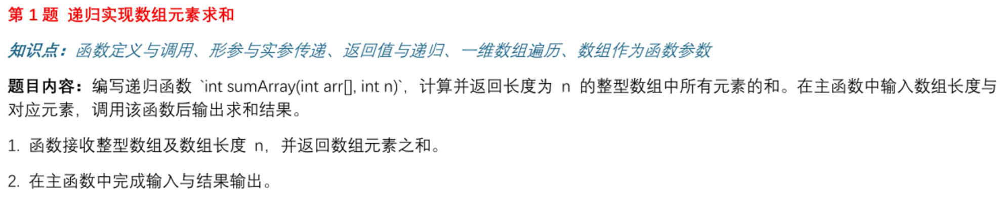
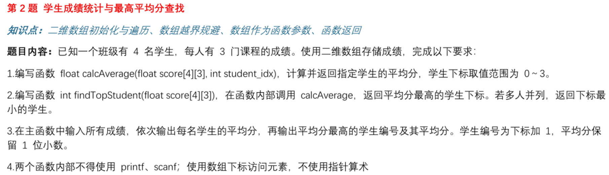
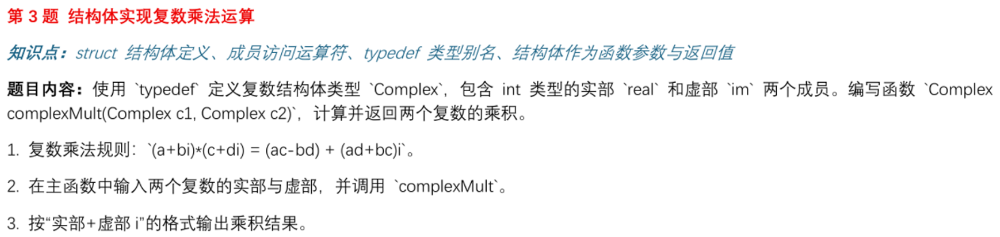
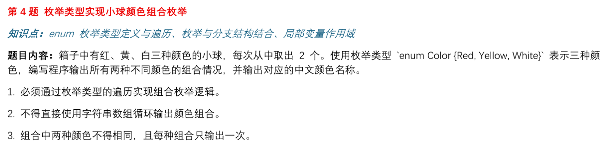
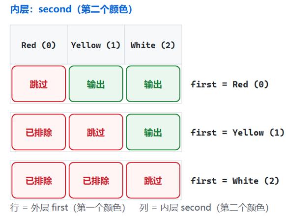
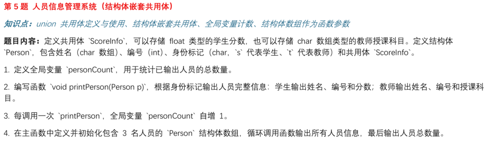

# 第三次培训：C 语言收尾与嵌入式开发导览

> 苍穹战队 · 电控组培训｜第二次作业讲评 / C 语言指针与内存模型 / STM32 学习路线

> 配套源码：[第二次作业标准答案](training-03-answers.md)

## 1. 培训总览

本次培训一共 **8 个部分**，下面是目录：

| # | 内容 |  |
|:---:|---|---|
| **1** | **培训总览** | 整场培训的目录 |
| **2** | **解答一些困惑** | 关于"进度"和"压力"，两句实话 |
| **3** | **第二次作业讲解** | 五道题的思路 + **规范答案源码** + 大家踩过的坑 |
| **4** | **C 语言指针与内存模型** | 一条建议 + 精选文章 / 视频 / 书单 |
| **5** | **STM32 单片机开发** | 8 层学习路线 + 怎么挑教程 + 资源清单 |
| **6** | **环境疑惑：现场演示** | 现场把"写代码 → 编译 → 烧录 → 灯亮"走一遍 |
| **7** | **常用模块与购买** | 小车常用模块清单 + 怎么挑、去哪儿买 |
| **8** | **答疑环节** | 现场提问 |

## 2. 解答一些困惑

### 2.1 关于进度：

不需要太担心自己的进度落后什么的，大家基础都差不多，都是会C语言和单片机点灯

<u>学的快不代表扎实</u>

大家还是抱有很强的竞争意识，但我们更需要的是关注自身进步和团队协作的人

真正会淘汰人的不是"进度慢"，而是"断掉不学了
进度慢可以补，断了就很难重来。

### 2.2 关于压力

> - "进度有点快，有点不知道该学哪方面"
> - "要学的太多，太忙了"
> - "时间不够，好多课都将期中考试了"
> - "害怕进度太快跟不上，又怕太慢来不及"
> - "跟不上作业进度了 😰"
> - "老大我们战队招人名额多少啊，我们认真学但好怕被同级那些有基础的拉爆啊 😭"
> - "感觉 500 元有点紧"

我的建议是，大家在前期学习的时候，先带着**不求甚解**的态度去学

你太想知道为什么了，太想知道具体的细节以及为什么会是这样，不完全搞明白就浑身不舒服那样

你快速过一遍主干和核心的东西，先不用完全搞明白，大概脑海里有个框架，然后需要细究里面一些东西的时候，在扎进去弄明白

| 诉求 |
|---|
| "想了解 stm32 的教学 / 需要学什么" |
| "不知道怎么在 CLion 上写代码以及烧录工具 / 用什么实体工具" |
| "stm 的扩展包并没有显示在 keil 上面" |
| "买的板子跟教程不一样 / 教的不是 HAL 库 / 找不到适合自己的教程" |
| "不会用 AI 提问"、"想推荐一些好的博主" |
| "怎么将练习的内容具体到小车的实践上" |
| "不会用电烙铁 / 焊接"、"整车电控布局" |

---

## 3. 第二次作业讲解


### 第一题



递归的好处就在于，用尽可能简洁且少量的代码，以及优异的时间和空间复杂度，就可以实现原本需要一大段代码且运行效率还不高的代码

#### 思路：

* **定义终止条件**
* **编写每一轮要做的事情**
* **提前相信你这个函数就能实现这个逻辑（类似高中数学的数学归纳法）**

核心代码就两行：

```c
int sumArray(const int arr[], int n){
	if (n <= 0) {return 0;}//终止条件
	return arr[n - 1] + sumArray(arr, n - 1);
}
```

把 n = 3 的调用展开看：

```c
sumArray(arr, 3)
 └─ arr[2] + sumArray(arr, 2)
              └─ arr[1] + sumArray(arr, 1)
                           └─ arr[0] + sumArray(arr, 0)
                                        └─ 0        ← 撞上出口
```

出口写 `n <= 0`，不要只写 `n == 1` 或 `n == 0`。

- 只写 `n == 0`：调用者传负数时无限递归 → 栈溢出 → 程序直接崩。
- 只写 `n == 1`：空数组（n = 0）时会走到"没有 `return` 的分支"，
  返回一个**不确定的值**（未定义行为）。这不是"结果不对"，是"结果随机"。


> 扩展题：**用递归实现n的阶乘/斐波那契数列**

有兴趣深入了解的可以看看这两个视频：

[8分钟搞懂“编程的鬼打墙”——递归](https://www.bilibili.com/video/BV14q5fzAEpD?vd_source=0ec807ca37217dda15dcd3c1863ba0c9)

[有个说法：“「递归」是检验编程天赋的试金石”；而本视频打破天赋壁垒，助你快速掌握递归。](https://www.bilibili.com/video/BV1LiS1YSEgF?vd_source=0ec807ca37217dda15dcd3c1863ba0c9)

---


### 第二题




#### 要拆成两个函数

- `calcAverage(score, i)` —— 只回答一个问题："第 i 个学生的平均分是多少？"
- `findTopStudent(score)` —— 只回答一个问题："谁的平均分最高？" 它**通过反复调用前一个函数**来回答。

两个函数都可以被别的程序直接调用、可以单独测试。

#### 为什么题目要禁止函数里用 `printf`/`scanf`

- 一旦 `calcAverage` 里混进 `printf`，它就只能当"给人看的程序"用，
  没法被别的模块调用，也没法拿一批测试数据自动验证对错。
- 在 STM32 工程里，驱动层函数里出现 `printf`
  是典型的设计错误——printf函数开销非常大，在中断里打印会直接拖垮整个系统。

#### 持续更新最高分

```
先让第 0 号当最高：top_idx = 0, top_avg = calcAverage(score, 0)
从 1 号开始逐个挑战：谁比我高，谁就当新最高
遍历结束，最高的的就是答案
```

---


### 第三题



难度不大，看答案源码自行理解

这里其实带有一点点**“面向对象”**思想在里面了，通过结构体把一组数据封装成一个具体的对象（理解不了对象就当成一种模板）

然后再在主程序需要这个对象的时候把这个对象声明出来

同时，编写 `ComplexMult`这种接口函数去操作这个对象里面的参数

比如，我封装好了一个电机的结构体对象，里面包含了电机转速，电流，角度等参数

我的底盘一共有四个电机，那么我就声明四个电机对象

---


### 第四题



**枚举的意义：让数字有名字。**
写 `White` 永远比写 `2` 清楚。看到 `2` 得回头查一遍定义，看到 `White` 不用。

**关键：内层循环从 `first + 1` 开始。**

```c
for (second = (Color)(first + 1); second <= White; second = (Color)(second + 1))
```

这一个写法**同时解决两个要求**：

- 排除了同色（自己不会跟自己组合）；
- 排除了重复（不会既输出 `红+黄` 又输出 `黄+红`）。

如果内层从 `Red` 开始、再加一句 `if (first != second)`，三种组合会变成六种。



---


### 第五题



#### 共用体是"同一块内存，两种解释"

```
       ScoreInfo（取两个成员中较大的那块空间）
       ┌──────────────────────────┐
 学生  │ float score              │  ← identity = 's'，按 float 读
       ├──────────────────────────┤
 教师  │ char subject[32]         │  ← identity = 't'，按字符串读
       └──────────────────────────┘
                     ↑
        靠 Person.identity 这个"标签"决定怎么读
```

**"同一段数据、根据标志位做不同解释"**：
协议解析（同一个缓冲区按不同报文类型解析）、寄存器位域复用、
事件联合体（一个事件结构体承载多种事件参数）。

---


### 普遍问题

1. **没有落实到"多文件"（最普遍的问题）。**
   题目最后一段明确要求"将每道题的全部源文件（`.c` 及需要的 `.h`）和编译生成的可执行文件独立文件夹"。
   STM32 工程动辄几十上百个文件，不可能全塞进 `main.c`。。

2. **源码中完全没有注释。**

3. **用变长数组 `int arr[n]`。**

   n 很大时会一次性在栈上开一大块，直接爆栈——这在 STM32 上是致命问题。
   → 规范做法：`#define MAX_N 100` + `int arr[MAX_N]` + 输入时做范围检查；需要动态大小就用 `malloc`/`free`。
   
4. **文件名不规范（不少同学）。**
   `未命名1.c`、`源.c`、`Untitled-1.c`、`1.c / 2.c / 3.c`


5. **变量命名。**
   如 `sunxiaochuan`、`caixukun`、`jinitaimei`。
   用 `a`、`b`、`x`、`temp` 表示"学生的平均分"。
   命名的标准是：**半年后你自己还能看懂。**

6. **`.c` 还是 `.cpp`。**

### 练习资料

对一些算法/刷题感兴趣的可以到[力扣 (LeetCode) ](https://leetcode.cn/)等平台找一些题目练习一下，对逻辑思维能力有一定帮助，同时，也可以看一些关于数据结构和算法的内容（见教程网站：[数据结构与算法 - 苍穹战队Robomaster电控组培训](https://xiaofxx.github.io/rm-ec-training/dsa/)）

---

## 4. 补充

（知乎 / CSDN/问AI即可，搜索引擎能筛出更好的）：

- 搜"**C 语言 内存四区 栈 堆 静态区**" 
- 搜"**C 语言 指针 数组 区别 指针算术**" 
- 搜"**C 语言 野指针 悬空指针 内存泄漏**" 
- 搜"**C 语言 内存对齐 struct 大小**" 

[一文轻松理解内存对齐 - 知乎](https://zhuanlan.zhihu.com/p/140063999)

[C语言重点——指针篇（一篇让你完全搞懂指针） - 知乎](https://zhuanlan.zhihu.com/p/101934152)

[C语言中内存布局(内存模型)是怎样的? - freshman_xy - 博客园](https://www.cnblogs.com/freshman-y/p/18780970)

[C语言内存模型下栈与堆的分配管理与实践-开发者社区-阿里云](https://developer.aliyun.com/article/1369400)


## 关于git使用

[Git+Github核心概念大串讲，从零到一全攻略，详细实战教程](https://www.bilibili.com/video/BV1ySLc6QEcB?vd_source=0ec807ca37217dda15dcd3c1863ba0c9)

这里推荐可以使用Clion/Vscode内部自带的git工具，版本流程很明显，代替终端敲命令/合并分支解决冲突很方便


---

## 5. STM32 单片机开发

### 5.1 学习路线


正确姿势是**以项目为驱动**

### 5.2 关于教程


跟学习指南上推荐的课程有出入，要么板子不一样，要么教的不是 HAL 库，不能很顺畅地学习。

| 判据 | 怎么检查 | 不满足怎么办 |
|:---:|---|---|
| **① 芯片型号一样或同系列** | 教程用 F103，你的板子是 F103 还是 F407？ | 型号不同**不是换教程的理由**——F1 和 F4 的 HAL 库接口几乎一样，差异自己查手册补。 |
| **② 库类型一样** | 教程用 HAL 还是标准库？ | 看函数名前缀：`HAL_GPIO_WritePin` 是 HAL；`GPIO_SetBits` 是标准库。**选定一种就别混着学。** |
| **③ 板子引脚对得上** | 教程的 LED 是 PA5，你的板子是吗？ | **去查你自己板子的原理图**，看 LED / 按键 / 串口引脚，改 CubeMX 里的引脚配置。 |

QQ公告网站已有大量教程，本次培训的目的还是在于解决大家动手实操的问题，以及遇到的一些教程里不会讲的问题

### 5.3 理解开发板，原理图

拿到任何一个开发板，都要学会**看手册，看手册**！

然后是**看原理图**

举例：（见教程视频）

### 5.4 资源推荐

- ST 官网：https://www.st.com/
- STM32 中文社区：https://shequ.stmicroelectronics.cn/
- 【立创开发板】简介 | 立创开发板技术文档中心：https://wiki.lckfb.com/zh-hans/products/

- RoboMaster 官网：https://www.robomaster.com/
- GitHub 搜索 `robomaster 电控` / `robomaster embedded`，能搜到大量战队开源代码。
- 下载一些优秀的代码框架，然后从中学习如何组织一个大的项目工程

### 5.5 关于HAL库

**结论：先用 HAL 把东西跑起来，再按需下沉到寄存器。**

- 没有人从零手写寄存器配置——那是浪费时间。

* **你不需要背下所有的API，遇到不会的就查需要哪个API，**

---

## 6.硬件部分

掌握基本的画简单**分电板**，**拓展板**的能力


不强求，不需要达到设计硬件的水平

以及看懂原理图的水平

[10分钟入门PCB电路设计！保姆级STM32最小系统板全流程！](https://www.bilibili.com/video/BV1bJw7znEhy?vd_source=0ec807ca37217dda15dcd3c1863ba0c9)

[2027嵌入式组培训 第一讲【导论与基本硬件知识】](https://www.bilibili.com/video/BV19ve868Euq?vd_source=0ec807ca37217dda15dcd3c1863ba0c9)

适当了解一些硬件知识对你的电控之路是非常有帮助的

## 7. Keil / CLion + ozone环境演示

照顾到大多数人都还是在点灯或者stm32入门的环节，这里主要帮大家演示一下环境问题：


---

## 8. 常用模块与购买

### 8.1 模块清单

| 类别 | 模块 / 器件 | 作用 | 参考链接 |
|---|---|---|:---:|
| **主控** | STM32F103C8T6 最小系统板 | 入门首选，便宜、资料最多 |  |
| **主控** | STM32F407 开发板 | 比赛主力，性能强、外设多 |  |
| **烧录 / 调试** | ST-Link V2 / J-Link | 下载程序 + 打断点调试 |  |
| **电源** | XT60 插头 | 整车供电 |  |
| **电源** | 降压模块（LM2596 / MP1584） | 降到 5V / 3.3V 给主控和传感器 |  |
| **电源** | 锂电池电压检测 / 分压电阻 | 电池电量监测 |  |
| **电机** | 直流减速电机 + 驱动模块（TB6612 / DRV8701 / L298N） | 入门小车用，便宜 |  |
| **电机** | MG996R / DS3218 舵机 | 转向、云台 |  |
| **传感** | IMU（BMI088 / ICM42688 / MPU6050） | 姿态解算，闭环控制必需 |  |
| **传感** | 超声波 HC-SR04 / 激光测距 TOF | 避障、测距 |  |
| **传感** | 增量式编码器 | 测速，做 PID 必需 |  |
| **通信** | HC-05 / HC-06 蓝牙模块 | 手机遥控、调试 |  |
| **通信** | ESP8266 / ESP32 模块 | WiFi 遥控、上位机通信 |  |
| **通信** | CAN 收发器 TJA1050 / SN65HVD230 | 与电调通信 |  |
| **显示** | OLED 0.96（SSD1306） | 显示调试信息，非常好用 |  |
| **基础** | 洞洞板 / 杜邦线 / 排针 / 排母 | 搭电路 |  |
| **基础** | XH2.54 / PH2.0 端子 + 压线钳 | 做正经接线，比杜邦线可靠 |  |
| **基础** | 开关 SS12D00 / 自锁按钮 | 电源开关 |  |
| **工具** | 电烙铁 + 焊锡 + 助焊剂 + 热缩管 | 焊接（**后续单独安排教学**） |  |
| **工具** | 万用表（必备）/ 示波器（进阶） | 排障 |  |

### 8.2 怎么找、怎么买（这部分比清单本身更重要）

**渠道**

| 渠道 | 特点 | 适合买什么 |
|---|---|---|
| **立创商城** https://www.szlcsc.com/ | 元件型号全、有数据手册、正品 | 电阻电容、芯片、接插件、模块 |
| **嘉立创** https://www.jlc.com/ | PCB 打样 + SMT 贴片 | 自己画的板子（进阶） |
| **淘宝 ** | 便宜、快 | 杜邦线、洞洞板、**模块**（**注意甄别**） |
| **得捷 / 贸泽** | 正品、贵、慢 | 关键器件、怕买到假货的东西 |

**挑模块的四条判断标准**

1. **主芯片型号明确。** 看到"XX 功能模块"但主芯片被磨掉型号的，**别买**。
2. **有公开的原理图或资料包。** 店家给资料包（原理图 + 例程）的，价值远高于没有的。
3. **标注了工作电压和通信电平。** 。
4. **有销量和评价，最好有实测反馈。**。

**搜索关键词怎么写**

- 不要搜"STM32 小车模块"，要搜具体型号：`STM32F103C8T6 最小系统板`、`TB6612 电机驱动模块`。
- 找数据手册：`<芯片型号> datasheet` 或 `<芯片型号> 数据手册 pdf`。
- 找别人的用法：`<模块名> STM32 HAL 例程`。

### 8.3 校内赛小车

[小车电控设计入门 - 苍穹战队Robomaster电控组培训](https://xiaofxx.github.io/rm-ec-training/school-car-design/)


